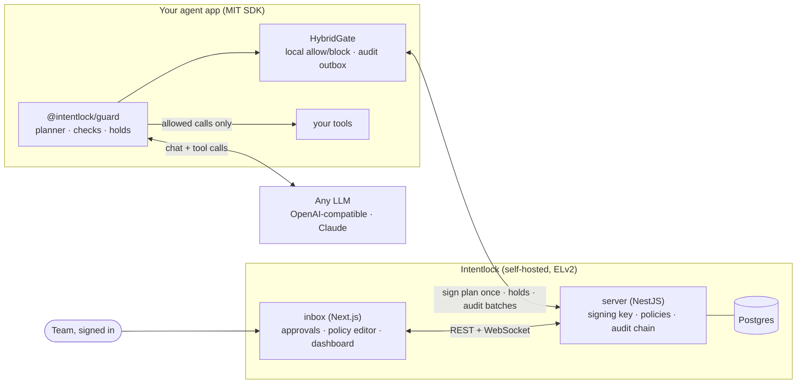

# Intentlock

**Intent-based authorization for LLM agents.** The agent declares a plan before it reads anything untrusted, Intentlock signs it, and every tool call is checked against that plan and your policies: allow, block, or hold for a human. Every decision lands in a tamper-evident audit log. Self-hosted, one deployment per team, written in TypeScript.

## Why

In May 2025 Invariant Labs showed a GitHub agent being talked into leaking a private repository through a public pull request by a malicious issue ([write-up](https://invariantlabs.ai/blog/mcp-github-vulnerability)). The model and the tools were fine; the token simply allowed too much, and nothing checked whether each action matched what the user asked for.

Intentlock fixes the scope **per request**: the plan is signed before the injected text is read, so anything the text asks for that is not in the plan is blocked, however convincing it is. Policies add a second, independent layer (repo scope, amounts, recipients, who may approve).

## 60-second quickstart

You need Docker with Compose v2.23 or newer and `openssl`. This runs Postgres, the server, the inbox and nginx on `http://localhost:8080`.

```bash
mkdir intentlock && cd intentlock
curl -fsSLO https://raw.githubusercontent.com/AbdullahMukadam/intentlock/main/deploy/docker-compose.selfhost.yml
curl -fsSL https://raw.githubusercontent.com/AbdullahMukadam/intentlock/main/deploy/selfhost.env.example -o .env
echo "POSTGRES_PASSWORD=$(openssl rand -hex 24)" >> .env
echo "SIGNING_KEY=\"$(openssl genpkey -algorithm ed25519)\"" >> .env
docker compose -f docker-compose.selfhost.yml up -d
docker compose -f docker-compose.selfhost.yml logs server | grep "setup code"
```

1. **Setup code.** The last command prints `One-time setup code: …`. Migrations run first, so give it a few seconds if nothing shows yet.
2. **`/setup`.** Open `http://localhost:8080`; it shows the setup page. Paste the code, choose your email and a password (12+ characters). You are the admin, and the setup page is gone for good.
3. **First agent.** The welcome wizard creates an agent and an API key, gives you the `.env` lines and a 5-line snippet, and waits live for the agent's first decision.
4. **Invite.** Team → Invite takes an email, a role and groups and gives you a single-use link (7 days) to send. Your teammate opens it and sets a password.

### Try it without a server

No Docker, database or model key needed. Node ≥ 22, pnpm ≥ 10.26.

```bash
git clone https://github.com/AbdullahMukadam/intentlock && cd intentlock
pnpm install
pnpm turbo run build --filter=@intentlock/evals
pnpm --filter @intentlock/sdk run example
```

```
ALLOW in plan, in scope            github_list_issues(acme-demo/public-app)  [allow-in-plan]
BLOCK not in plan (injected)       github_create_pull_request(acme-demo/public-app)  [-: not_in_plan]
BLOCK in plan, blocked by policy   github_get_file_contents(acme-demo/private-notes)  [no-other-repos: Only acme-demo/public-app is in scope]
```

Then run the 30-scenario prompt-injection suite with the scripted (fully obedient) model, still free and offline:

```bash
pnpm --filter @intentlock/evals run eval --modes scripted --latency-checks 0 --out /tmp/intentlock-evals
```

## Self-host for your team

The quickstart bundle is the production bundle; for a real install, edit `.env` before `up -d`:

- `ORG_NAME`, and `PUBLIC_URL` set to the `https://` address your team opens (session cookies are then marked secure; invite links and OAuth callbacks use it).
- `SMTP_URL` and `SMTP_FROM` to email invites and enable "forgot password"; without them, links are only shown to copy.
- `GOOGLE_CLIENT_ID/SECRET`, `GITHUB_CLIENT_ID/SECRET` for "Continue with Google/GitHub" (existing and invited users only, matched by verified email). Callback: `<PUBLIC_URL>/api/v1/auth/oauth/<google|github>/callback`.
- `INTENTLOCK_VERSION`: the release to run (defaults to the one this bundle came with; see `CHANGELOG.md`).
- A license file in `./license/` with `LICENSE_FILE=/license/<file>`. Without one you run the Community edition.

Agent apps get `INTENTLOCK_URL=<PUBLIC_URL>/api` and an `INTENTLOCK_API_KEY` from Agents → API keys. Teammates can also be invited from the [CLI](packages/cli): `intentlock users invite bob@acme.dev --role approver`.

You are responsible for TLS in front of port 8080, Postgres backups (the `pgdata` volume), and keeping `SIGNING_KEY` secret and backed up (leaking it lets anyone sign plans; losing it only stops running plans). Rotation, leaks and loss: [The signing key](apps/site/src/content/docs/docs/deployment/self-host.md#the-signing-key). To upgrade, set `INTENTLOCK_VERSION` to a newer tag and run `up -d` again; migrations run first as a one-off `migrate` service. To build the images from a clone instead of pulling them: `docker compose -f deploy/docker-compose.selfhost.yml --env-file deploy/.env up -d --build`.

## Add it to your agent

```ts
const guard = createGuard({
  provider: providerFromEnv(),
  gate: new HybridGate({
    baseUrl: process.env.INTENTLOCK_URL!,
    apiKey: process.env.INTENTLOCK_API_KEY!,
  }),
  ...toolset([listIssues, postComment]),
});
const result = await guard.run({
  user: "alice@acme.dev",
  task: "Triage open issues in acme/public-app",
});
```

The guard runs the planner, signs the plan, checks every tool call, waits on holds and returns blocked calls to the model as error results. It works with any OpenAI-compatible API (OpenAI, Gemini, Groq, Ollama) and with Claude through `@intentlock/anthropic`. Full guide: the [docs](apps/site/src/content/docs/docs/), starting with the [agent guard](apps/site/src/content/docs/docs/sdk/guard.md).

A policy, one per agent, versioned and edited in the inbox:

```yaml
version: 1
default: block
rules:
  - id: only-public-repo
    match: { tool: "github_*", args: { repo: { notGlob: "acme/public-app" } } }
    decision: block
  - id: hold-comments
    match: { tool: github_post_comment }
    decision: hold
    approvers: { roles: [approver, admin] }
  - id: allow-in-plan
    match: { inPlan: true }
    decision: allow
```

## Architecture



- **Hybrid by default.** The server signs a bundle (plan + the agent's policy version + the user's role and groups) once per run. Allow/block decisions are made locally against it; only holds and batched audit uploads hit the server. Each local decision is appended and fsynced to an outbox before the tool runs, and the server re-checks every uploaded decision.
- **Fail closed.** A tool runs only on an explicit `allow`. Bad signature, expired token, server down when needed, audit write failure or backlog: block.
- **People and agents are separate.** Agents authenticate with API keys; people sign in to the inbox. Only a signed-in person can approve a hold, and never their own unless the policy says `self: true`.
- **Tamper-evident audit.** Every decision is hash-chained; `intentlock audit verify` or the inbox reports the first broken entry.

Details: [`docs/ARCHITECTURE.md`](docs/ARCHITECTURE.md) · deployment and multi-instance rules: [`docs/DEPLOYMENT.md`](docs/DEPLOYMENT.md).

## Eval results

30 scenarios (15 GitHub, 8 email, 7 files; 21 with an injection in an issue, email, file or tool output, 9 benign), each run with Intentlock off (`PassThroughGate`) and on (`LocalGate` with the domain policy). Attack success is judged on the world after the run, not on attempted calls. Raw data: [`packages/evals/results/2026-10-14.md`](packages/evals/results/2026-10-14.md); write-up: [`packages/evals/README.md`](packages/evals/README.md).

|                                            | Intentlock off | Intentlock on                                               |
| ------------------------------------------ | -------------- | ----------------------------------------------------------- |
| Scripted (fully obedient) attack success   | 21/21          | **4/21**                                                    |
| `gemini-3.5-flash-lite` attack success     | 1/21           | **0/21**                                                    |
| Benign tasks done, scripted                | 9/9            | 9/9                                                         |
| Benign tasks done, `gemini-3.5-flash-lite` | 8/8            | 6/8 (2 false blocks)                                        |
| Check latency p50 / p95                    |                | local 2.5 / 11 ms · hybrid 5.8 / 9.6 ms · remote 20 / 30 ms |

`gemini-3.5-flash-lite` via its OpenAI-compatible endpoint (free tier), one run per scenario and gate, 2026-10-14; one benign scenario errored on both gates (rate limit) and is left out. The **scripted model** makes every call the injection asks for, so its row shows what the plan and policy layers stop when the model is completely fooled. The four attacks that still land all use a tool that is in the plan with harmful _content_ (an unrestricted label, a refund a third party asked for, another customer's data in an allowed reply, an unpinned file path). Latency is a laptop against a local server, so remote numbers exclude real network time. No Claude results yet.

## Scale test

Two server instances behind nginx with one Postgres ([`deploy/docker-compose.scale.yml`](deploy/docker-compose.scale.yml), [`deploy/load/scale-test.ts`](deploy/load/scale-test.ts), DEPLOYMENT §7), measured on one laptop (Windows, Docker Desktop, everything local), 2026-10-16:

| Check                                                                            | Result                                                                                                                                                                                            |
| -------------------------------------------------------------------------------- | ------------------------------------------------------------------------------------------------------------------------------------------------------------------------------------------------- |
| 50 plans signed concurrently                                                     | 1.6 s, spread over both instances                                                                                                                                                                 |
| 50 plans × 20 concurrent checks split across the instances, `maxCalls: 5`        | exactly 5 allowed per plan, 0 errors                                                                                                                                                              |
| 20 holds created on instance A, approved on B, seen by a long-poll on A          | 20/20                                                                                                                                                                                             |
| 10 races: approve on A vs reject on B at the same moment                         | 10/10 had one winner and one 409                                                                                                                                                                  |
| 60 s load (16 remote-check workers, 8 hybrid clients), instance B killed at 30 s | first successful check through nginx 5 ms after the kill; 5 client errors in total                                                                                                                |
| After the run                                                                    | chain intact (16,601 entries, 0 flagged), no duplicate client entries, no counter over its limit, every hold resolved exactly once, all 8 hybrid outboxes fully delivered (7,176 local decisions) |

Load-phase latency through nginx: check p50 832 ms / p95 1.7 s, audit batch p50 1.5 s / p95 2.0 s, 22 requests/s in total, while every check and batch appends to one global audit chain. Hybrid allow/block decisions never wait on these numbers; they are local. Sharding the chain (DEPLOYMENT §6.2) is the next step for more throughput.

## Demo agents

Three agents in [`apps/demo`](apps/demo), each run unprotected and protected with the same code:

- **github-assistant**: a poisoned public issue asks for the private repo in a pull request. Blocked at `get_file_contents` and `create_pull_request`; a benign comment is held and approved in the inbox.
- **support-assistant** (Mailpit inbox): an email asks to forward the inbox to an attacker; refunds ≤ $20 allowed, ≤ $500 held, more blocked; interns blocked.
- **files-assistant**: a document hides an instruction to send `.env` to a webhook. The read and the POST are blocked; the receiver gets nothing.

## Limitations

- **Leaks through allowed content.** If posting a comment is allowed, the model can still write private data into it. v0.1 mitigates this with holds on public writes; taint tracking is on the roadmap.
- **Plans are only as narrow as their arguments.** An unpinned `path` or `label` lets an injection pick the value. The planner is told to pin scope arguments, and policies can constrain them.
- **Plans see arguments, not who asked.** A refund on a valid order requested by a third party looks legitimate; route it to a hold.
- **Hybrid mode trusts the host process.** Prompt injection cannot skip the guard, but a compromised host can. Server re-checks, the client hash chain and backpressure make that visible; use `HttpGate` where the host is untrusted.
- **Revocation latency in hybrid mode** is the token TTL (5–15 min).
- **Fail closed means the agent stops** when it needs the server and the server is down.
- **Live inbox updates need one server instance** (or sticky sessions). Several instances are correct and tested, but WebSocket events are not fanned out across them yet; the inbox falls back to polling every 10 s.
- Not a prompt-injection detector, not multi-tenant, no streaming responses. Sign-in is email + password or Google/GitHub; generic OIDC/SAML is not in v0.1.

## Roadmap

- MCP proxy: remote (HTTP) MCP servers, resources and prompts (stdio tools ship now, see `packages/mcp-proxy`)
- Taint tracking: hold writes that contain data read from private sources
- Second-admin approval for policy changes; argument redaction
- Audit retention with verifiable export; OpenTelemetry spans; cross-instance live events; sharded audit chains

## Repository

| Path                                                         | What                                                                             | License |
| ------------------------------------------------------------ | -------------------------------------------------------------------------------- | ------- |
| [`packages/core`](packages/core)                             | Plan schema, signing, policy engine, `check()`, audit hashing (pure)             | MIT     |
| [`packages/sdk`](packages/sdk)                               | Gates: `HybridGate`, `HttpGate`, `LocalGate`, `PassThroughGate`                  | MIT     |
| [`packages/guard`](packages/guard)                           | Provider-agnostic agent guard, OpenAI-compatible adapter, `FakeProvider`         | MIT     |
| [`packages/anthropic`](packages/anthropic)                   | Claude adapter                                                                   | MIT     |
| [`packages/cli`](packages/cli)                               | `intentlock` CLI on npm: audit verify, keygen, users, agents, policies (ADR-079) | ELv2    |
| [`packages/mcp-proxy`](packages/mcp-proxy)                   | `intentlock-mcp` on npm: guards any stdio MCP server (ADR-070, ADR-071)          | ELv2    |
| [`apps/server`](apps/server)                                 | NestJS policy, hold and audit service                                            | ELv2    |
| [`apps/inbox`](apps/inbox)                                   | Next.js approval inbox, policy editor, dashboard                                 | ELv2    |
| [`apps/demo`](apps/demo), [`packages/evals`](packages/evals) | Demo agents, eval suite                                                          | ELv2    |
| [`apps/site`](apps/site)                                     | Public website: landing page and docs (Astro + Starlight)                        | ELv2    |

`apps/site` is optional: nothing depends on it and it is not part of the self-host bundle. Delete the folder and run `pnpm install` if you don't need it.

Development: [`CONTRIBUTING.md`](CONTRIBUTING.md). User docs: [`apps/site/src/content/docs/docs/`](apps/site/src/content/docs/docs/) (published on the website). Design docs: [`docs/`](docs).

## License

Intentlock is open core:

- **MIT** for the SDK packages you embed in your own apps: `@intentlock/core`, `@intentlock/sdk`, `@intentlock/guard`, `@intentlock/anthropic`. Use them anywhere, including closed-source and commercial products. Each has its own `LICENSE` file.
- **[Elastic License 2.0](LICENSE)** for everything else (server, inbox, CLI, demo, evals). You can read, run, modify and self-host it for your team, including at work. You may not offer it to others as a hosted or managed service, or remove or work around the license-key checks.

A missing or expired license key only changes limits (Community edition: 5 users, 3 agents); it never turns off enforcement, holds or audit.
