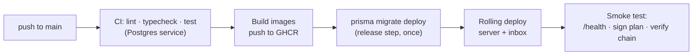

# Deployment and scaling — Intentlock

**Status:** v1 · Intentlock is **self-hosted by each customer team** (single-tenant). §10 is what a customer runs; §9 is **our own private instance** — we self-host exactly like a customer team, for the demo and the video (sign-in required, nothing public). Covers how v0.1 is deployed, what scales horizontally today, what is designed but not built, and how we prove it. Read `ARCHITECTURE.md` §5–6 first.

## 1. Deployment topology


| Component | Artifact | Where (v0.1) | Scales by |
| --- | --- | --- | --- |
| Server | Docker image, `apps/server/Dockerfile` (multi-stage, `node:22-slim`, non-root) | Render free web service (§9) | More instances behind the LB (paid tier) |
| Inbox | Docker image or Vercel, Next.js `output: "standalone"` | Vercel Hobby (§9) | More instances (stateless) |
| Database | Managed Postgres 16 | Neon free (§9) | Vertical; pooler; read replica for audit reads |
| Public website | Static `apps/site/dist` (`apps/site/wrangler.jsonc`) | Cloudflare Workers static assets (§9.2) | Cloudflare's network; not part of an install |
| SDK clients | npm packages inside the user's app | User's infrastructure | With the app; one outbox dir per process |
| Demo agent | Runs locally (needs GitHub + model keys) | Not deployed publicly | — |

The v0.1 free hosting choice and its limits are in §9 (ADR-017).

## 2. Configuration and secrets

All config comes from environment variables, validated with zod at boot (`apps/server/src/config/env.schema.ts`). The server refuses to start on invalid config.

The variable reference (server, inbox, self-host bundle, agent apps) lives in the site: [`apps/site/src/content/docs/docs/deployment/environment-variables.md`](../apps/site/src/content/docs/docs/deployment/environment-variables.md) (ADR-066). Add a new variable there and to `env.schema.ts` in the same change. Signing-key rotation is on the site's [self-hosting](../apps/site/src/content/docs/docs/deployment/self-host.md#rotating-the-signing-key) page.

## 3. Release pipeline



- In `.github/workflows/ci.yml`: `check` (format, lint, typecheck, test with Postgres) on every push and PR → `images` on `main` and `v*` tags: server and inbox built with Buildx (GitHub Actions cache) and pushed to `ghcr.io/abdullahmukadam/intentlock-server|inbox` as `latest` (main), `sha-<commit>` and, for tags, `X.Y.Z` and `X.Y` → `release` on `main` (GitHub environment `production`): `prisma migrate deploy` against the `PRODUCTION_DIRECT_URL` secret, then the `RENDER_DEPLOY_HOOK` secret. Each release step is skipped while its secret is unset, so forks and a repo without a deployment only build images.
- GHCR creates new packages as private. After the first push, make both packages public (GitHub → Packages → package settings → visibility) so the self-host bundle can pull them without a login.
- Migrations run **once per release** as a separate step, never on instance boot (two instances booting together would race).
- Migrations must be backward compatible with the previous release (add columns, then use them in a later release), so a rolling deploy never breaks running instances.
- `/health` = process up; `/health/ready` = database reachable + signing key loaded. The LB routes only to ready instances.
- Graceful shutdown: on `SIGTERM` stop accepting connections, let in-flight requests and long-polls finish (≤ 25 s), close the DB pool.

## 4. What scales horizontally, and why

The single biggest scaling decision is already made: in **hybrid mode, allow/block decisions never reach the server**. Server load is proportional to plans signed, holds, and audit batches (one request per ~5 s per active client), not to tool calls.

| Concern | Status | Why it works across instances |
| --- | --- | --- |
| Plan signing | ✅ v0.1 | Every instance has the same key; signing is stateless |
| JWKS / verification | ✅ v0.1 | Same keys everywhere; clients cache JWKS |
| Remote `check` | ✅ v0.1 | Pure `check()` + DB reads; usage counters updated atomically (§5.1) |
| Hold creation, approval, wait | ✅ v0.1 | State in Postgres; long-poll reads the DB, so any instance can answer |
| Audit batch ingest | ✅ v0.1 | Idempotent on `(planId, clientSeq)`; retries can land anywhere |
| Hold expiry job | ✅ v0.1 | Idempotent query, safe on every instance (§5.2) |
| Live inbox events (WebSocket) | ⚠️ designed, stretch | Needs cross-instance fan-out (§6.1) |
| Global audit chain | ⚠️ designed, stretch | Correct across instances, but serialized (§6.2) |
| Postgres | ⚠️ single primary | Vertical + pooler + read replica (§6.3) |

## 5. Built in v0.1 (correctness under multiple instances)

### 5.1 Atomic counters

Never read-modify-write a counter in application code.

```sql
UPDATE "StepUsage"
SET calls = calls + 1
WHERE "planId" = $1 AND step = $2 AND calls < $3   -- $3 = maxCalls
RETURNING calls;
```

Zero rows returned = limit reached → `block / call_limit`. (Prisma: `update` with `increment` inside a conditional `updateMany`, or `$queryRaw` for the `RETURNING` form.)

### 5.2 Idempotent hold expiry

```sql
UPDATE "Hold"
SET status = 'EXPIRED', "resolvedAt" = now()
WHERE status = 'PENDING' AND "expiresAt" < now()
RETURNING id;
```

Safe to run on every instance every 10 s: a hold can only move out of `PENDING` once. Audit entries are written only for the returned ids. Approve/reject use the same guard (`WHERE id = $1 AND status = 'PENDING'`), so a late approve on an expired hold fails cleanly.

### 5.3 No shared in-memory state

Instances keep no state that another instance needs: no in-memory hold maps, no local caches that affect decisions (policies are read from the database per request; signing keys are loaded identically from env). Long-poll waits poll the DB every 1 s inside the 25 s window.

### 5.4 Audit chain appends under concurrency

Appends take a transaction-scoped advisory lock (`pg_advisory_xact_lock(<chain id>)`) before reading the chain head, so concurrent appends from any instance serialize correctly. The lock is held only for the head read and one multi-row insert, until commit. Hybrid batch ingest (ADR-061) does its slow work outside that lock: hashing, token checks and decision re-checks run before the transaction; the client-sequence head, gap and chain-break checks and reports run under a per-plan lock (`pg_advisory_xact_lock(<namespace>, hashtext(planId))`); the whole batch is then appended in one go. Every path takes the chain lock last, so the locks cannot form a cycle.

## 6. Designed, not built in v0.1

### 6.1 Cross-instance live events

Problem: an approver's WebSocket is on instance A; the hold is created on instance B.

Design: every instance `LISTEN`s on a Postgres channel `intentlock_events`; the instance that creates or resolves a hold does `pg_notify('intentlock_events', <json>)`; each instance forwards to its own WebSocket clients. No new infrastructure. Payloads stay small (ids only; clients fetch details) because `NOTIFY` payloads are size-limited. At larger scale swap for Redis pub/sub (Socket.IO Redis adapter).

v0.1 workaround: run the inbox's WebSocket against a single instance, or enable sticky sessions on the LB. Holds are still never lost, because the inbox also polls `GET /v1/holds?status=pending` every 10 s.

### 6.2 Sharded audit chains with a global anchor

Problem: one global chain serializes every append.

Design: one chain per organization in a future hosted version, or per API key / agent within a self-hosted install (the `orgId` column makes the first possible). Every few seconds, a single anchoring job (leader via advisory lock) computes a Merkle root over all chain heads and appends it to a small global chain. Writes on different chains no longer contend; verifying one org needs only its chain plus the anchors; tampering anywhere breaks either the shard chain or the anchor.

### 6.3 Database scaling

- Connection pooler (PgBouncer / platform pooler) in front of Postgres; Prisma in pooled mode.
- Read replica for `GET /v1/audit` and the inbox audit viewer.
- Partition `AuditEntry` by month once it grows large; old partitions exported to object storage as verifiable JSONL.

### 6.4 Client-side considerations

- Each app process needs its own outbox directory; on platforms with ephemeral disks, mount a volume or accept the in-memory fallback (documented risk: a crash loses unflushed entries for that process).
- Server outages: hybrid clients keep allowing/blocking until backpressure (≤ 500 entries or 60 s), then block. Holds need the server.

## 7. Proving it in v0.1

`deploy/docker-compose.scale.yml` runs **two server instances** behind nginx, plus Postgres and the inbox. A load script (`deploy/load/scale-test.ts`) then:

1. Signs 50 plans concurrently, round-robined across instances.
2. Fires remote checks and hybrid audit batches at both instances for 60 s.
3. Creates holds on instance A and approves them through instance B.
4. Kills one instance mid-run (`docker compose kill server-2`) and confirms clients recover through the other.
5. Verifies: audit chain intact, no duplicate `(planId, clientSeq)`, no counter exceeded `maxCalls`, every hold ended in exactly one state.

Results (requests/s, p95 latency, errors) go in the journal and the README. Numbers are only what was measured. Run it with `pnpm tsx deploy/load/scale-test.ts` (builds the images first) or `--no-build` to reuse images already built; `--keep` leaves the stack running. `REMOTE_WORKERS`, `HYBRID_CLIENTS` and `HYBRID_PAUSE_MS` change the load. Holds and races run before the load phase so the instance that resolves them is still alive.

## 8. Local and production commands

```bash
# local full stack
docker compose up -d                     # postgres + mailpit (demo)
pnpm dev                                 # server + inbox

# scale test (add --no-build to reuse built images)
docker compose -f deploy/docker-compose.scale.yml up -d --build
pnpm tsx deploy/load/scale-test.ts

# production release (CI does this)
pnpm --filter @intentlock/server prisma migrate deploy
```

## 9. Our private instance on free hosting (v0.1 choice)

We run Intentlock the way a customer team would: one private install, sign-in required, used by us to run the demo agents and record the video. Recruiters see the video, not the instance.

Chosen in ADR-017. None of these need a credit card. Limits change often: re-check before deploying and note the date in the journal.

| Part | Service | Free-tier behaviour to plan for |
| --- | --- | --- |
| Server | **Render** free web service (Docker) | Sleeps after 15 minutes without inbound HTTP or WebSocket traffic; the first request then takes ~1 minute; kept awake by an external monitor on `/health` (§9.1, ADR-065). 750 instance hours/month per workspace, shared by all free services (one always-on instance uses ~720–744). Ephemeral disk. Single instance only. |
| Database | **Neon** free Postgres | Permanent free plan: 0.5 GB storage, 100 CU-hours of compute and 5 GB public transfer per project per month. Compute scales to zero after 5 idle minutes (slower first query). |
| Inbox | **Vercel** Hobby | Personal / non-commercial use. 100 GB transfer/month. Proxied (rewrite) requests time out after 30–120 s depending on the docs version; the hold long-poll waits at most 25 s. Cold starts possible. |
| Images | **GHCR** | Public images. |
| Scale test | **Local** `docker compose` | Two instances + nginx (§7); numbers come from here, not from the free tier. |

**Do not use:** Render free Postgres (expires after 30 days, then deleted), Fly.io (card required, no free tier for new users), Koyeb (free plan closed to new users).

Limits last checked 2026-10-16 (Render, Neon and Vercel docs).

### 9.1 Step by step

The generic steps any team follows (Neon, migrate, signing key, Render, Vercel, first admin, checks, keep-awake monitor) and the Render variable table live in the site: [`apps/site/src/content/docs/docs/deployment/free-hosting.md`](../apps/site/src/content/docs/docs/deployment/free-hosting.md) (ADR-066). Our instance follows them with these differences:

- **Images and releases.** CI builds and pushes the images (§3). Migrations run in the `release` job with the GitHub environment `production` secret `PRODUCTION_DIRECT_URL`; Render's deploy hook goes into the `RENDER_DEPLOY_HOOK` secret and Render's auto-deploy is off.
- **Vercel check.** `curl.exe -i https://<domain>/api/v1/setup/status` answers `{"setupRequired":true}`; `DNS_HOSTNAME_RESOLVED_PRIVATE` means the build had no `API_URL` and forwards to `localhost`.
- **Sample users.** `INTENTLOCK_DEMO=1` on Render: setup also creates the sample users and prints their passwords once in the logs.
- **Demo agents (laptop).** In `apps/demo/.env`: `INTENTLOCK_URL=https://<vercel>/api`, `INTENTLOCK_ADMIN_EMAIL`, `INTENTLOCK_ADMIN_PASSWORD`. Then `pnpm --filter @intentlock/demo setup-instance` (agents, policies, API keys into `apps/demo/.env`), `pnpm --filter @intentlock/demo seed`, and run an agent.
- **Regions (ADR-063).** Vercel `sin1`, Render Singapore, Neon `ap-southeast-1`.
- **Monitor (ADR-065).** UptimeRobot or cron-job.org on Render's `/health` every 5 minutes.

**Setup notes**
- Neon gives a **pooled** and a **direct** connection string. The server uses the pooled one at runtime (`DATABASE_URL`); migrations use the direct one (`DIRECT_URL`, read by `prisma.config.ts`). If the pooler ever rejects a query the app needs, point `DATABASE_URL` at the direct string; at demo scale either works.
- Render runs the image CI built and tested; migrations run in CI's `release` job before the deploy hook fires (§3), so Render needs no pre-deploy command and auto-deploy stays off.
- The instance is private: every page needs sign-in (ARCHITECTURE §5.6). We complete setup with the code from Render's logs and invite users; `INTENTLOCK_DEMO=1` adds sample users at setup.
- The **demo agents run on our laptop**, pointing at the instance with their API keys (`apps/demo/.env`), exactly like a team's agent apps. Model keys, GitHub tokens and Mailpit stay local; no secrets other than the server's own live on hosted services.
- Policies are not deployed with the server: the demo `setup` script publishes them into the instance via the API.
- Cold starts are acceptable: in hybrid mode only plan signing, holds and audit uploads touch the server. Open the inbox a minute before recording.
- For shots that need live updates (split screen, holds appearing instantly), record against the local `docker compose` install, which has WebSockets; use the deployed instance to show it running online.
- Free databases have no backups. Treat the deployment as a live demo; the source of truth for results is the repo (`packages/evals/results/`, journal).

### 9.2 Public website on Cloudflare (ADR-069)

The landing page and docs (`apps/site`) are a static Worker on Cloudflare, separate from the instance. Nothing deploys from a laptop; Workers Builds builds from GitHub.

1. **Create.** Cloudflare dashboard → Workers & Pages → Create → Import a repository → this repo. Worker name `intentlock-site` (it must match `name` in `apps/site/wrangler.jsonc`).
2. **Build settings.** Root directory: the repo root. Build command `pnpm turbo run build --filter=@intentlock/site`. Deploy command `npx wrangler deploy --config apps/site/wrangler.jsonc`. Non-production branch command `npx wrangler versions upload --config apps/site/wrangler.jsonc` (a preview URL per branch build).
3. **Build variables** (build only, not runtime): `PNPM_VERSION=10.34.6` (the default 10.11.1 is older than the repo needs), `NODE_VERSION=24`, `SITE_URL=https://intentlock-site.<account>.workers.dev` (or the custom domain), `INBOX_URL=https://<vercel-domain>` (Sign in links).
4. **Check.** `/` is the landing page, `/docs/` the docs with working search, an unknown path shows the 404 page, light/dark and phone width look right, `og:url` uses `SITE_URL`.
5. **Inbox link.** Vercel → `NEXT_PUBLIC_DOCS_URL=<SITE_URL>/docs/` for Production → Redeploy. The sidebar shows "Docs" under General.

## 10. Self-hosting (what a customer team runs)


**One origin.** The inbox and API are served from the same origin through the bundled nginx (`/api/v1/*` → server `/v1/*`, `/api/socket.io` → server `/socket.io` with WebSocket upgrade, everything else → inbox). Session cookies then work with `SameSite=Lax`, with no CORS, and the browser never talks to the server's port directly.

**Install, upgrade and operator responsibilities** are on the site's [self-hosting](../apps/site/src/content/docs/docs/deployment/self-host.md) page (ADR-066).

The bundle is one file: the nginx config is inline (`configs.content`, Compose ≥ 2.23) and gzips API responses (`application/json`, `application/x-ndjson`; the inbox compresses its own, and on the hosted instance Vercel already serves brotli), the server and inbox images come from GHCR (`ghcr.io/abdullahmukadam/intentlock-server|inbox`, tag `INTENTLOCK_VERSION`), and each service also has a `build:` section so `up --build` from a clone builds them locally. The server runs with `TRUST_PROXY=1` so login rate limits and audit see the client IP from nginx. The compose project is named `intentlock-selfhost` so it never shares volumes with the dev `docker-compose.yml`.
**Free-hosted instance caveat (§9):** on Vercel + Render, the inbox reaches the API through a Next.js rewrite (`/api/*` → Render), which keeps cookies same-origin. Vercel rewrites don't proxy WebSockets, so the hosted demo relies on the inbox's 10 s polling for new holds. The self-host bundle has live WebSockets.

