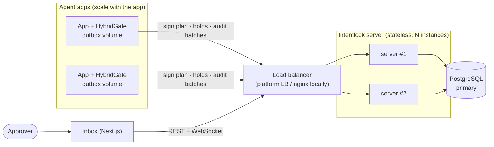
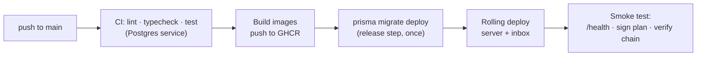
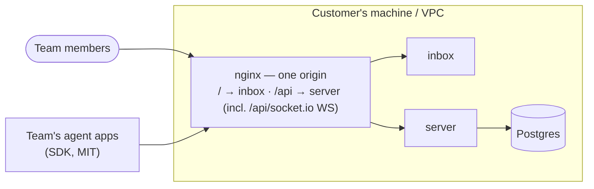

# Deployment and scaling — Intentlock

**Status:** v1 · Intentlock is **self-hosted by each customer team** (single-tenant). §10 is what a customer runs; §9 is **our own private instance** — we self-host exactly like a customer team, for the demo and the video (sign-in required, nothing public). Covers how v0.1 is deployed, what scales horizontally today, what is designed but not built, and how we prove it. Read `ARCHITECTURE.md` §5–6 first.

## 1. Deployment topology



| Component | Artifact | Where (v0.1) | Scales by |
| --- | --- | --- | --- |
| Server | Docker image, `apps/server/Dockerfile` (multi-stage, `node:22-slim`, non-root) | Render free web service (§9) | More instances behind the LB (paid tier) |
| Inbox | Docker image or Vercel, Next.js `output: "standalone"` | Vercel Hobby (§9) | More instances (stateless) |
| Database | Managed Postgres 16 | Neon free (§9) | Vertical; pooler; read replica for audit reads |
| SDK clients | npm packages inside the user's app | User's infrastructure | With the app; one outbox dir per process |
| Demo agent | Runs locally (needs GitHub + model keys) | Not deployed publicly | — |

The v0.1 free hosting choice and its limits are in §9 (ADR-017).

## 2. Configuration and secrets

All config comes from environment variables, validated with zod at boot (`apps/server/src/config/env.schema.ts`). The server refuses to start on invalid config.

| Variable | Used by | Notes |
| --- | --- | --- |
| `DATABASE_URL` | server | Pooled URL in production |
| `DIRECT_URL` | server (migrations) | Direct, non-pooled URL for `prisma migrate deploy` |
| `SIGNING_KEY` | server | Ed25519 PKCS8 PEM; **same value on every instance**; platform secret store only |
| `SIGNING_KEY_PREVIOUS` | server | Optional; old key still published in JWKS during rotation |
| `API_KEY_PEPPER` | server | Optional extra secret for API key hashing |
| `CORS_ORIGINS` | server | Only needed if the inbox is served from another origin (avoid; see §10) |
| `ORG_NAME` | server | Name of the single organization, used on first boot |
| `BOOTSTRAP_ADMIN_EMAIL` | server | First admin, created on first boot; a one-time login token is printed to the logs |
| `LICENSE_FILE` | server | Optional path to a license JWS; absent = Community edition |
| `PUBLIC_URL` | server, inbox | External URL of the single origin (cookies, links) |
| `INTENTLOCK_DEMO` | server | `1` on first boot seeds sample users for a demo install; never set in real installs |
| `API_URL` | inbox | Server base URL behind the `/api/*` rewrite (build time) |
| `DEMO_RUNNER_URL` | inbox | Local demo runner behind `/demo-runner/*` (default `http://localhost:8790`; dev/recording only) |
| `LLM_*`, `GITHUB_TOKEN` | demo, evals | Local only, never on the server |

Key rotation: deploy with the new `SIGNING_KEY` and the old one in `SIGNING_KEY_PREVIOUS`; JWKS publishes both `kid`s; after the max token TTL (≤ 60 min) remove the old one.

## 3. Release pipeline



- Migrations run **once per release** as a separate step, never on instance boot (two instances booting together would race).
- Migrations must be backward compatible with the previous release (add columns, then use them in a later release), so a rolling deploy never breaks running instances.
- `/health` = process up; `/health/ready` = database reachable + signing key loaded. The LB routes only to ready instances.
- Graceful shutdown: on `SIGTERM` stop accepting connections, let in-flight requests and long-polls finish (≤ 25 s), close the DB pool.

## 4. What scales horizontally, and why

The single biggest scaling decision is already made: in **hybrid mode, allow/block decisions never reach the server**. Server load is proportional to plans signed, holds, and audit batches (one request per ~5 s per active client), not to tool calls.

| Concern | Status | Why it works across instances |
| --- | --- | --- |
| Plan signing | ✅ v0.1 | Every instance has the same key; signing is stateless |
| JWKS / verification | ✅ v0.1 | Same keys everywhere; clients cache JWKS |
| Remote `check` | ✅ v0.1 | Pure `check()` + DB reads; usage counters updated atomically (§5.1) |
| Hold creation, approval, wait | ✅ v0.1 | State in Postgres; long-poll reads the DB, so any instance can answer |
| Audit batch ingest | ✅ v0.1 | Idempotent on `(planId, clientSeq)`; retries can land anywhere |
| Hold expiry job | ✅ v0.1 | Idempotent query, safe on every instance (§5.2) |
| Live inbox events (WebSocket) | ⚠️ designed, stretch | Needs cross-instance fan-out (§6.1) |
| Global audit chain | ⚠️ designed, stretch | Correct across instances, but serialized (§6.2) |
| Postgres | ⚠️ single primary | Vertical + pooler + read replica (§6.3) |

## 5. Built in v0.1 (correctness under multiple instances)

### 5.1 Atomic counters

Never read-modify-write a counter in application code.

```sql
UPDATE "StepUsage"
SET calls = calls + 1
WHERE "planId" = $1 AND step = $2 AND calls < $3   -- $3 = maxCalls
RETURNING calls;
```

Zero rows returned = limit reached → `block / call_limit`. (Prisma: `update` with `increment` inside a conditional `updateMany`, or `$queryRaw` for the `RETURNING` form.)

### 5.2 Idempotent hold expiry

```sql
UPDATE "Hold"
SET status = 'EXPIRED', "resolvedAt" = now()
WHERE status = 'PENDING' AND "expiresAt" < now()
RETURNING id;
```

Safe to run on every instance every 10 s: a hold can only move out of `PENDING` once. Audit entries are written only for the returned ids. Approve/reject use the same guard (`WHERE id = $1 AND status = 'PENDING'`), so a late approve on an expired hold fails cleanly.

### 5.3 No shared in-memory state

Instances keep no state that another instance needs: no in-memory hold maps, no local caches that affect decisions (policies are read from the database per request; signing keys are loaded identically from env). Long-poll waits poll the DB every 1 s inside the 25 s window.

### 5.4 Audit chain appends under concurrency

Appends take a transaction-scoped advisory lock (`pg_advisory_xact_lock(<chain id>)`) before reading the chain head, so concurrent appends from any instance serialize correctly. Hybrid batches append many entries under one lock acquisition, which keeps lock traffic low.

## 6. Designed, not built in v0.1

### 6.1 Cross-instance live events

Problem: an approver's WebSocket is on instance A; the hold is created on instance B.

Design: every instance `LISTEN`s on a Postgres channel `intentlock_events`; the instance that creates or resolves a hold does `pg_notify('intentlock_events', <json>)`; each instance forwards to its own WebSocket clients. No new infrastructure. Payloads stay small (ids only; clients fetch details) because `NOTIFY` payloads are size-limited. At larger scale swap for Redis pub/sub (Socket.IO Redis adapter).

v0.1 workaround: run the inbox's WebSocket against a single instance, or enable sticky sessions on the LB. Holds are still never lost, because the inbox also polls `GET /v1/holds?status=pending` every 10 s.

### 6.2 Sharded audit chains with a global anchor

Problem: one global chain serializes every append.

Design: one chain per organization in a future hosted version, or per API key / agent within a self-hosted install (the `orgId` column makes the first possible). Every few seconds, a single anchoring job (leader via advisory lock) computes a Merkle root over all chain heads and appends it to a small global chain. Writes on different chains no longer contend; verifying one org needs only its chain plus the anchors; tampering anywhere breaks either the shard chain or the anchor.

### 6.3 Database scaling

- Connection pooler (PgBouncer / platform pooler) in front of Postgres; Prisma in pooled mode.
- Read replica for `GET /v1/audit` and the inbox audit viewer.
- Partition `AuditEntry` by month once it grows large; old partitions exported to object storage as verifiable JSONL.

### 6.4 Client-side considerations

- Each app process needs its own outbox directory; on platforms with ephemeral disks, mount a volume or accept the in-memory fallback (documented risk: a crash loses unflushed entries for that process).
- Server outages: hybrid clients keep allowing/blocking until backpressure (≤ 500 entries or 60 s), then block. Holds need the server.

## 7. Proving it in v0.1

`deploy/docker-compose.scale.yml` runs **two server instances** behind nginx, plus Postgres and the inbox. A load script (`deploy/load/scale-test.ts`) then:

1. Signs 50 plans concurrently, round-robined across instances.
2. Fires remote checks and hybrid audit batches at both instances for 60 s.
3. Creates holds on instance A and approves them through instance B.
4. Kills one instance mid-run (`docker compose kill server-2`) and confirms clients recover through the other.
5. Verifies: audit chain intact, no duplicate `(planId, clientSeq)`, no counter exceeded `maxCalls`, every hold ended in exactly one state.

Results (requests/s, p95 latency, errors) go in the journal and the README. Numbers are only what was measured.

## 8. Local and production commands

```bash
# local full stack
docker compose up -d                     # postgres + mailpit (demo)
pnpm dev                                 # server + inbox

# scale test
docker compose -f deploy/docker-compose.scale.yml up -d --build
pnpm tsx deploy/load/scale-test.ts

# production release (CI does this)
pnpm --filter @intentlock/server prisma migrate deploy
```

## 9. Our private instance on free hosting (v0.1 choice)

We run Intentlock the way a customer team would: one private install, sign-in required, used by us to run the demo agents and record the video. Recruiters see the video, not the instance.

Chosen in ADR-017. None of these need a credit card. Limits change often: re-check before deploying and note the date in the journal.

| Part | Service | Free-tier behaviour to plan for |
| --- | --- | --- |
| Server | **Render** free web service (Docker) | Sleeps after 15 idle minutes; first request then takes ~1 minute. 750 instance hours/month (one always-on instance). 5 GB bandwidth/month. Single instance only. |
| Database | **Neon** free Postgres | Permanent free plan, 1 GB storage per project. Compute suspends after 5 idle minutes (slower first query). |
| Inbox | **Vercel** Hobby | Personal / non-commercial use. Cold starts possible. |
| Images | **GHCR** | Public images. |
| Scale test | **Local** `docker compose` | Two instances + nginx (§7); numbers come from here, not from the free tier. |

**Do not use:** Render free Postgres (expires after 30 days, then deleted), Fly.io (card required, no free tier for new users), Koyeb (free plan closed to new users).

**Setup notes**
- Neon gives a **pooled** and a **direct** connection string. Prisma uses the pooled one at runtime (`DATABASE_URL`) and the direct one for migrations (`DIRECT_URL`, set as `directUrl` in `schema.prisma`).
- Render: deploy `apps/server/Dockerfile`; health check path `/health/ready`; set `SIGNING_KEY`, `DATABASE_URL`, `DIRECT_URL`, `CORS_ORIGINS`. Run `prisma migrate deploy` as Render's pre-deploy command (single instance, so no race).
- Vercel: root directory `apps/inbox`; set `API_URL` to the Render URL.
- The instance is private: every page needs sign-in (ARCHITECTURE §5.6). Users are created by us; first boot may use `INTENTLOCK_DEMO=1` for sample users.
- The **demo agents run on our laptop**, pointing at the instance with their API keys (`apps/demo/.env`), exactly like a team's agent apps. Model keys, GitHub tokens and Mailpit stay local; no secrets other than the server's own live on hosted services.
- Policies are not deployed with the server: the demo `setup` script publishes them into the instance via the API.
- Cold starts are acceptable: in hybrid mode only plan signing, holds and audit uploads touch the server. Open the inbox a minute before recording.
- For shots that need live updates (split screen, holds appearing instantly), record against the local `docker compose` install, which has WebSockets; use the deployed instance to show it running online.
- Free databases have no backups. Treat the deployment as a live demo; the source of truth for results is the repo (`packages/evals/results/`, journal).

## 10. Self-hosting (what a customer team runs)



**One origin.** The inbox and API are served from the same origin through the bundled nginx (`/api/v1/*` → server `/v1/*`, `/api/socket.io` → server `/socket.io` with WebSocket upgrade, everything else → inbox). Session cookies then work with `SameSite=Lax`, with no CORS, and the browser never talks to the server's port directly.

**Install**
```bash
curl -O https://raw.githubusercontent.com/<owner>/intentlock/main/deploy/docker-compose.selfhost.yml
cp .env.example .env        # set ORG_NAME, BOOTSTRAP_ADMIN_EMAIL, PUBLIC_URL, SIGNING_KEY (intentlock keygen)
docker compose -f docker-compose.selfhost.yml up -d
docker compose logs server | grep "login token"     # first admin login
```
Then: sign in at `PUBLIC_URL`, run `intentlock login` + `intentlock users add <email> --role approver`, create an API key for each agent app, and (optionally) drop a license file at `LICENSE_FILE`.

**Operator responsibilities** (documented in the README): TLS in front of nginx, Postgres backups, keeping `SIGNING_KEY` secret, upgrading by pulling new image tags (migrations run as a one-off `migrate` service in the compose file before `server` starts).

**Free-hosted instance caveat (§9):** on Vercel + Render, the inbox reaches the API through a Next.js rewrite (`/api/*` → Render), which keeps cookies same-origin. Vercel rewrites don't proxy WebSockets, so the hosted demo relies on the inbox's 10 s polling for new holds. The self-host bundle has live WebSockets.

