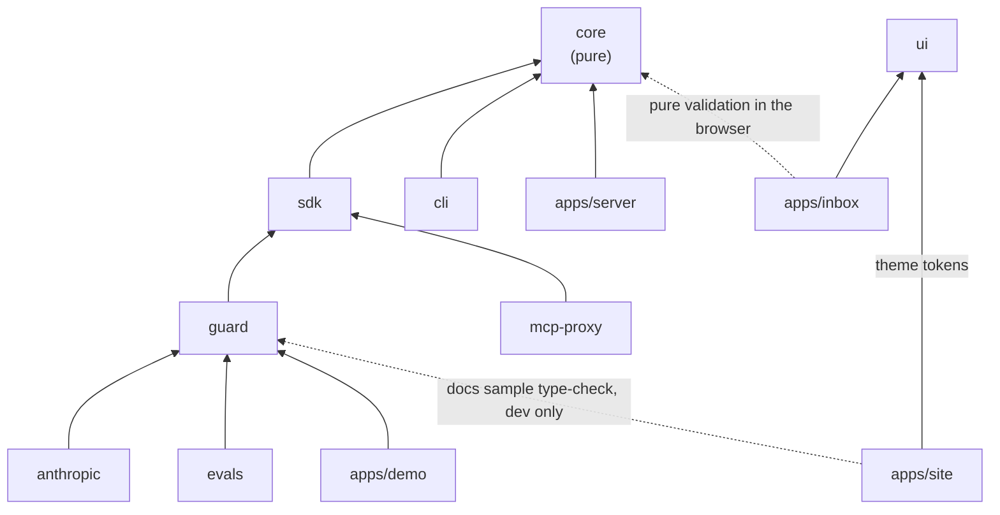

# Project structure — Intentlock

**Status:** v1 · Phase 0 scaffolds this tree. New files go where this document says; if something doesn't fit, update this file (and add an ADR if it changes a package boundary).

## 1. Top level

```
intentlock/
├── .github/
│   └── workflows/
│       └── ci.yml                  # install → lint → typecheck → test (+ Postgres service for server tests)
├── apps/
│   ├── server/                     # NestJS policy + audit service
│   ├── inbox/                      # Next.js approval inbox, audit viewer, split-screen demo page
│   ├── demo/                       # three demo agents (github, support, files), setup + seed scripts, runner
│   └── site/                       # public website: landing page + docs (Astro + Starlight, static; ADR-066). Optional: delete it if you don't need it
├── packages/
│   ├── core/                       # pure: schemas, hashing, tokens, plan matching, policy engine, check(), audit hashing
│   ├── sdk/                        # Gate interface: HybridGate (+ outbox), HttpGate, LocalGate, PassThroughGate
│   ├── guard/                      # provider-agnostic agent guard + OpenAI-compatible + Fake providers
│   ├── anthropic/                  # AnthropicProvider
│   ├── cli/                        # `intentlock` CLI: audit verify, keygen, policy validate
│   ├── evals/                      # prompt-injection scenario suite + runner
│   ├── mcp-proxy/                  # MCP stdio proxy (intentlock-mcp)
│   ├── ui/                         # shared shadcn/ui components + design tokens (styles/tokens.css, light + dark for `.dark` and `[data-theme="dark"]`; styles/theme.css = Tailwind theme on top of the tokens; styles/globals.css = Tailwind + theme + sources for the inbox) and Panel, Badge (ADR-059)
│   └── config/                     # shared tsconfig presets + eslint config incl. import-boundary rules (§4)
├── deploy/
│   ├── docker-compose.selfhost.yml # what customers run: server + inbox + Postgres + nginx (GHCR images); nginx single-origin config inline
│   ├── selfhost.env.example        # the .env customers fill in for the self-host bundle
│   ├── docker-compose.scale.yml    # 2 server instances + nginx + Postgres + inbox
│   ├── nginx/nginx.conf            # round-robin LB for the scale test
│   └── load/scale-test.ts          # multi-instance load + failure test (DEPLOYMENT §7)
├── docs/                           # PRD, ARCHITECTURE, STRUCTURE, DEPLOYMENT, PLAN, JOURNAL, DECISIONS
├── CLAUDE.md
├── README.md
├── LICENSE                         # Elastic License 2.0 (everything except the MIT packages)
├── scripts/
│   ├── issue-license.ts            # vendor-only license issuer (`pnpm issue-license`); validates with the server's LicenseSchema
│   ├── release.ts                  # `pnpm release [--dry-run]`: checks, builds and publishes the MIT packages, pushes vX.Y.Z (ADR-062)
│   └── create-test-db.sql          # run by the postgres container on first start: creates intentlock_test
├── package.json                    # root scripts only (turbo), devDeps for tooling
├── pnpm-workspace.yaml             # apps/*, packages/*
├── bts.jsonc                       # Better-T-Stack project config (keep; used by `add`)
├── turbo.json                      # build / dev / test / lint / typecheck pipelines
├── .nvmrc                          # Node 22 LTS
├── .gitignore                      # node_modules, dist, .env*, !.env.example, .intentlock/, keys/, coverage
├── (no root .env.example)          # each app has its own: apps/server, apps/inbox, apps/demo, packages/evals (a root .env is still read as a fallback)
├── .prettierrc / .prettierignore   # docs/ and CLAUDE.md are excluded from formatting
└── docker-compose.yml              # postgres:16 (dev + test databases); mailpit added in Phase 5
```

## 2. Every package has the same shape

```
packages/<name>/
├── src/
│   ├── index.ts                    # public API only — re-exports; nothing else imports deeper paths
│   └── ...
├── test/fixtures/                  # recorded responses, sample files (only if needed)
├── package.json                    # "name": "@intentlock/<name>", "exports" → dist, "type": "module", "license"
├── LICENSE                         # MIT — only in core, sdk, guard, anthropic
├── tsconfig.json                   # extends the packages/config node preset
├── tsup.config.ts                  # ESM + .d.ts
├── eslint.config.js                # `export default intentlock("<name>")` from @intentlock/config/eslint
└── README.md                       # what it is, 5-line usage, API summary
```

Tests live in each app's or package's `test/` folder, never in `src/` (ADR-052): unit tests in `test/unit/` mirroring the `src/` path (`src/policy/evaluate.ts` → `test/unit/policy/evaluate.test.ts`; files outside `src/`, like inbox's `next.config.ts`, sit at the root of `test/unit/`), integration tests in `test/e2e/` as `*.e2e.test.ts`, shared fixtures in `test/fixtures/`.

## 3. Package-by-package

### `packages/core` — pure, no I/O

```
src/
├── index.ts
├── api/
│   └── endpoints.ts                # API_ENDPOINTS (every server route) + apiPath()
├── enums/                          # verdict, block-reason, client-block-reason, client-entry-kind, report-outcome (*.enum.ts)
├── schemas/
│   ├── plan.ts                     # Plan, PlanStep, ArgConstraint
│   ├── tool-call.ts                # ToolCall
│   ├── decision.ts                 # Decision (allow | block | hold), GateDecision (hold + holdId)
│   ├── policy.ts                   # PolicySet, Rule, Match
│   ├── bundle.ts                   # signed bundle claims (plan, pol, polh, role)
│   └── audit.ts                    # AuditEntry, ClientEntry
├── canonical.ts                    # jcs() + sha256Base64url()
├── crypto/
│   ├── keys.ts                     # generate/import/export Ed25519, kid thumbprint
│   └── bundle-token.ts             # signBundle(), verifyBundle() (jose, injected now)
├── plan/
│   └── match-step.ts               # matchStep(plan, call) + arg constraint matchers
├── policy/
│   ├── parse.ts                    # YAML string → PolicySet (yaml + zod), readable errors
│   ├── match.ts                    # tool / args / user / inPlan / except matching
│   └── evaluate.ts                 # ordered rules, first match wins, default block
├── check.ts                        # pure check(bundle, call, usage, now) + decide() fail-closed wrapper (ARCHITECTURE §4)
├── audit/
│   ├── hash-entry.ts               # server chain hashing
│   ├── verify-chain.ts             # first broken seq
│   └── client-chain.ts             # hashClientEntry(), chainClientEntry() (outbox local hash chain)
└── errors.ts
```

### `packages/sdk`

```
src/
├── index.ts
├── gate.ts                         # Gate interface, SignedPlan, shared types
├── errors.ts                       # GateUnavailableError (fail closed), HttpError
├── enums/                          # hold-status, http-method
├── http/
│   ├── client.ts                   # fetch wrapper: base URL, API key, keep-alive, timeouts, injectable fetch
│   ├── http-gate.ts                # remote mode
│   └── wait-for-hold.ts            # long-poll loop shared by both gates
├── hybrid/
│   ├── hybrid-gate.ts              # local verify + decide(), per-plan usage, holds via server, backpressure, crash recovery
│   └── jwks-cache.ts               # jose remote JWKS set (prefetched at start, refetch on unknown kid)
├── outbox/
│   ├── memory-outbox.ts            # in-memory outbox + the shared per-plan state; serverless fallback
│   ├── file-outbox.ts              # extends it: <planId>.jsonl append + fsync, .ack (atomic rename), .done, recover()
│   └── worker.ts                   # timer (unref), batches ≤ maxBatch with de-duplicated tokens, backoff + jitter, drain()
├── local-gate.ts
├── passthrough-gate.ts
└── shutdown.ts                     # SIGTERM/SIGINT → close()
```

### `packages/guard`

```
src/
├── index.ts
├── provider/
│   ├── types.ts                    # LLMProvider, ChatRequest/Response, Message, ToolDef, ToolCallReq
│   ├── openai-compatible.ts        # Gemini / Groq / OpenRouter / Ollama via baseURL
│   ├── fake.ts                     # FakeProvider (scripted)
│   └── from-env.ts                 # providerFromEnv() with zod-validated LLM_* vars
├── guard/
│   ├── create-guard.ts             # public factory, options validation
│   ├── options.ts                  # zod schema for GuardOptions
│   ├── planner.ts                  # declare_plan call, retry once, fail closed
│   ├── loop.ts                     # run(): turns, concurrent checks, max turns
│   ├── execute.ts                  # one turn's tool calls → results
│   ├── results.ts                  # block / error result text builders
│   ├── checkpoint.ts               # Checkpoint schema + CheckpointError (ADR-080)
│   ├── resume.ts                   # resume(): match holds to the checkpoint, settle them, continue the loop
│   └── events.ts                   # event types + emitter
├── checkpoints/                    # store.ts (CheckpointStore), codec.ts (AES-256-GCM), file-store.ts, s3-store.ts, sigv4.ts
└── tools/
    └── define-tool.ts              # defineTool({ name, description, schema: zod, impl }) → ToolDef + impl
```

### `packages/anthropic`

```
src/
├── index.ts
├── anthropic-provider.ts           # implements LLMProvider
└── mapping.ts                      # neutral ↔ Messages API (tool_use / tool_result)
test/fixtures/                      # hand-written / recorded Messages API responses
```

### `packages/cli`

```
src/
├── index.ts                        # exports buildProgram() and run() (for tests)
├── bin.ts                          # the `intentlock` binary: real fetch, home dir, stdin prompt
├── program.ts                      # commander setup, CliError → exit code 1
├── errors.ts                       # CliError
├── api/                            # api-client.ts (session cookie + CSRF header), session-api.ts, resolve-agent.ts (name → id)
├── session/session-store.ts        # ~/.intentlock/session.json (0600)
├── constants/ · enums/ · types/    # cli.constants, http-method, cli-context.type (injectable fetch/home/print/prompt)
├── utils/columns.util.ts           # aligned table output
├── testing/fake-context.ts         # fake fetch router + captured output for tests
└── commands/
    ├── audit-verify.ts             # verify an exported JSONL chain offline
    ├── login.ts                    # store a session for the CLI
    ├── users.ts                    # users add | list | disable | token (admin)
    ├── agents.ts                   # agents create | list | disable (admin)
    ├── keys.ts                     # keys create | list | revoke --agent <name> (admin)
    ├── policy.ts                   # policy pull | test | push --agent <name>
    ├── keygen.ts                   # create an Ed25519 signing key (PEM, UTF-8, 0600)
    └── policy-validate.ts          # lint a policy YAML file
```

### `packages/evals`

```
src/
├── index.ts
├── scenario.ts                     # ScenarioSpec, Scenario, DomainKit, scenarioFor() (binds a spec to its mock world)
├── domains.ts                      # githubKit / emailKit / filesKit + githubScenario() etc.
├── policies.ts                     # loadPolicy(domain) from policies/<domain>.yaml
├── enums/                          # domain, injection-site, http-method, <domain>-tool
├── mocks/                          # in-memory backends (state + seed data + judge helpers)
│   ├── github.ts
│   ├── email.ts
│   └── files.ts
├── tools/                          # tool definitions bound to the mocks
│   ├── github.ts
│   ├── email.ts
│   └── files.ts
├── scenarios/
│   ├── index.ts                    # SCENARIOS (all 30)
│   ├── github/gh-001-private-leak-pr.ts …  # one file per scenario; gh-u* are utility-only
│   ├── email/em-001-forward-inbox.ts …
│   ├── files/fs-001-exfil-env.ts …
│   └── <domain>/common.ts · index.ts       # shared tasks, judges, scripted calls; the domain list
├── runner/
│   ├── run.ts                      # runScenario(): one scenario × gate × provider; logs calls, blocks, check latency, tokens
│   ├── scripted.ts                 # model-free baseline: FakeProvider replaying exploit + solution under an honest plan
│   ├── latency.ts                  # check-latency bench: local, hybrid (fsynced outbox), remote
│   ├── metrics.ts                  # attack rate, utility, false blocks, latency percentiles
│   └── report.ts                   # results JSON + markdown table
└── cli.ts                          # `pnpm --filter @intentlock/evals run eval [--runs N] [--modes scripted,model] [--only ids]`
policies/                           # github.yaml, email.yaml, files.yaml
results/                            # committed outputs: <date>.json, <date>.md
```

### `packages/mcp-proxy` (ADR-070)

```
src/
├── index.ts
├── bin.ts                          # intentlock-mcp: spawn upstream over stdio, HybridGate, serve the client over stdio
├── args.ts                         # --plan, --user, --list-tools, -- <upstream command>
├── plan-file.ts                    # plan file (goal + steps) → signed plan input
├── upstream-env.ts                 # environment for the upstream server, without INTENTLOCK_* variables
├── proxy.ts                        # createProxy: planned tools only, tools/call through the gate, return-and-retry holds
└── enums/
test/
├── unit/                           # args, plan file, upstream env, proxy (in-memory MCP transports)
└── fixtures/                       # harness (fake upstream + scripted gate), upstream-server.mjs for stdio smoke runs
```

### `apps/server` — NestJS, one module per feature

```
Dockerfile                          # multi-stage, node:22-slim, non-root
prisma.config.ts                    # Prisma 7 CLI config: schema path, migrations, DIRECT_URL (loads apps/server/.env, then the root .env)
.env.example                        # every variable the server reads, with comments
prisma/
├── schema.prisma
├── migrations/
└── seed.ts                         # dev / --demo only: org, admin/approver/member/intern users
src/
├── main.ts
├── app.module.ts                   # modules + global guards, in order: CsrfGuard → ApiKeyGuard → SessionGuard → RolesGuard
├── configure-app.ts                # logger, exception filter, global ZodValidationPipe; shared by main.ts and the e2e tests
├── generated/prisma/               # Prisma client (git-ignored; `prisma generate` runs on postinstall)
├── config/                         # env.schema.ts (zod), config.module.ts, enums/ (node-env, log-level)
├── common/                         # cross-cutting, one concern per file (ADR-033)
│   ├── constants/                  # auth.constants.ts (metadata keys, CSRF header), http.constants.ts (Retry-After, X-Request-Id), db.constants.ts
│   ├── decorators/                 # public, agent-auth, roles, current-user, current-agent (*.decorator.ts)
│   ├── enums/                      # auth-kind, error-code, logger-context, prisma-error-code, driver-error-kind, pg-error-code, fs-error-code, server-timing-metric (*.enum.ts)
│   ├── filters/                    # http-exception.filter.ts (ADR-060: 4xx pass through, transient DB → 503, bugs → 500)
│   ├── guards/                     # csrf.guard.ts, roles.guard.ts
│   ├── logger/                     # create-logger.util.ts (adds requestId to every line), pino-logger.service.ts
│   ├── middleware/                 # request-id.middleware.ts (X-Request-Id + AsyncLocalStorage), server-timing.middleware.ts (Server-Timing: total + db time and query count)
│   ├── pipes/                      # zod-validation.pipe.ts (global, fail closed)
│   ├── schemas/                    # shared zod field schemas (email.schema.ts)
│   ├── types/                      # auth.types.ts (SessionUser, AgentCaller, AuthedRequest), verdict-counts.type.ts
│   └── utils/                      # crypto, zod-dto, auth-kind, ulid, to-json, decision (isHold/isBlock), verdict-counts, db-error (*.util.ts)
├── prisma/                         # prisma.module.ts, prisma.service.ts
├── org/                            # org.module.ts, org-bootstrap.service.ts (runs on boot)
│   └── utils/                      # bootstrap-org.util.ts (also used by the seed), org-db.util.ts (org-scoped client)
├── auth/                           # auth.module/controller/service (methods, login, logout, me, password forgot/reset; rate limits)
│   ├── sessions.service.ts         # the one session check, shared by SessionGuard and the WebSocket handshake
│   ├── constants/                  # session.constants.ts
│   ├── types/                      # resolved-session.type.ts, session-row.type.ts (session joined with its user)
│   ├── dto/                        # login, forgot-password, reset-password
│   ├── enums/                      # auth-error, login-throttler
│   ├── guards/                     # session.guard.ts (default deny)
│   ├── oauth/                      # oauth.controller/service: Google + GitHub start/callback (PKCE, signed state cookie), provider config
│   └── utils/                      # session-cookie.util.ts, password.util.ts (scrypt hash/verify, strength rules)
├── setup/                          # setup.module/controller/service: GET status, POST setup (setup code from the logs, ADR-058)
│                                   # org/utils: bootstrap-org (org + setup code on boot), create-demo-users (INTENTLOCK_DEMO)
├── invites/                        # invites.controller (admin: create, list, resend, revoke), invite-accept.controller (public: lookup, accept), invites.service
├── account/                        # account.module/controller/service: password, sessions, identities, CLI token (signed-in user)
├── mail/                           # mail.module, mail.service.ts (nodemailer, on when SMTP_URL is set; a failed send returns false, never throws)
├── users/                          # users.module/controller/service (admin only): list, update, reset link
│   ├── dto/                        # update-user, user-email-params (*.dto.ts)
│   ├── enums/                      # user-role (matches the Prisma Role enum, tested), user-error
│   ├── schemas/                    # user-fields.schema.ts
│   └── utils/                      # to-public-user.util.ts
├── agents/                         # agents.module/controller/service: CRUD, 24 h counts, DELETE = disable, maxAgents
│   ├── constants/                  # agent.constants.ts (webhook URL length, secret prefix)
│   ├── dto/                        # create-agent, update-agent, agent-id-params, set-agent-webhook
│   ├── enums/                      # agent-error
│   ├── schemas/                    # agent-fields.schema.ts (kebab-case name, id)
│   ├── utils/                      # create-agent.util.ts (agent + starter policy v1), to-agent-view.util.ts
│   └── api-keys/                   # api-keys.module/controller/service: create (shown once), list, revoke
│       ├── dto/                    # create-api-key, api-key-params
│       ├── enums/                  # api-key-error
│       ├── guards/                 # api-key.guard.ts (@AgentAuth routes)
│       └── utils/                  # api-key.util.ts (il_live_ keys, hashing), to-api-key-view.util.ts
├── license/                        # license.module/controller/service: verify at boot + every 24 h, limits, GET /v1/license
│   ├── constants/                  # community-license, license.constants (DI token, lock id), vendor-public-key
│   ├── enums/                      # license-edition, license-feature, license-status, licensed-resource, license-error
│   ├── schemas/                    # license.schema.ts
│   ├── types/                      # license-check.type.ts
│   └── utils/                      # verify-license.util.ts (offline JWS verify), to-license-view.util.ts
├── keys/                           # keys.module/controller/service: SIGNING_KEY load (dev: generate), JWKS, verifyForAgent()
│   ├── types/                      # verified-bundle.type.ts
│   └── utils/                      # normalize-pem.util.ts
├── policies/                       # policies.module/controller/service: draft, validate, test (samples + replay), publish (409), rollback, versions
│   ├── constants/                  # policy.constants.ts (size limits)
│   ├── dto/                        # save-draft, validate-policy, test-policy, publish-policy, rollback-policy, policy-version-params
│   ├── enums/                      # policy-error
│   ├── schemas/                    # policy-fields.schema.ts, check-payload.schema.ts (what replay reads from audit)
│   └── utils/                      # compile-policy, to-policy-version-view, to-policy-draft-view
├── stats/                          # stats.module/controller/service: GET /v1/stats/overview (raw SQL aggregates, role-scoped)
│   ├── constants/ · dto/ · enums/  # stats.constants, overview-query.dto, stats-bucket + stats-error
├── runs/                           # runs.module/controller/service: GET /v1/runs, /v1/runs/:planId (members: own only)
│   ├── constants/ · dto/ · enums/  # runs.constants, list-runs-query + run-params, run-status + run-error
│   ├── schemas/                    # run-entry-payload.schema.ts
│   └── utils/                      # run-status.util.ts (expired is derived from expiresAt)
├── plans/                          # plans.module/controller/service: POST /v1/plans, /refresh (stored plan, current policy)
│   ├── constants/ · enums/ · schemas/ · dto/   # plan.constants, plan-error, plan-fields (PlanSchema, TokenSchema), sign/refresh/params DTOs
│   └── utils/                      # unsafe-regexes.util.ts (ReDoS heuristic at signing)
├── check/                          # check.module/controller/service: POST /v1/check (verify → check() → atomic counter → hold → audit, one tx)
│   ├── dto/                        # check-call.dto.ts
│   └── utils/                      # to-check-audit.util.ts (check payload contract)
├── holds/                          # holds.module/controller/service: create (hybrid), list, approve/reject, long-poll wait, expiry job
│   ├── hold-notifier.service.ts    # hold emails + HOLD_WEBHOOK_URL (ADR-072)
│   ├── hold-webhooks.service.ts    # HoldEvent outbox: enqueue in the resolve tx, SKIP LOCKED delivery, retries (ADR-080)
│   ├── constants/ · enums/ · dto/ · types/   # hold.constants, hold-state + hold-error + webhook-delivery-outcome, create/wait/list/resolve DTOs, new-hold.type
│   └── utils/                      # hold-state.util.ts (DB ↔ API status), to-hold-view.util.ts, to-hold-wait-view.util.ts, webhook-retry.util.ts
├── reports/                        # reports.module/controller/service: POST /v1/report (ran counts, plan completion)
│   ├── enums/ · schemas/ · dto/    # report-error, checked-call.schema, report.dto (ReportOutcome comes from core)
│   └── utils/                      # plan-progress.util.ts (findCheckedCall, recordRun, updateCompletion; shared with batch ingest)
├── audit/
│   ├── audit.service.ts            # serialized chain append
│   ├── audit-query.service.ts      # role-scoped list, cursor pagination, JSONL export
│   ├── batch.service.ts            # /v1/audit/batch ingest under the chain lock: chain check, re-run check(), flags
│   ├── verify.service.ts           # walks the global chain in batches
│   ├── audit.controller.ts
│   ├── constants/ · dto/           # audit.constants, audit-query.dto, audit-batch.dto (tokens + tokenRef)
│   ├── enums/                      # audit-kind, audit-origin, audit-verdict, audit-format, audit-flag, audit-error, batch-reject-reason
│   ├── types/                      # audit-input.type.ts
│   └── utils/                      # to-audit-entry.util.ts (row → core AuditEntry), decisions-agree.util.ts (looser-than-policy test)
├── events/                         # events.module, events.gateway.ts (WebSocket /events, session checked in handshake middleware),
│   │                               # events.service.ts (per-socket viewer, filtered publish, session recheck every 60 s)
│   ├── constants/ · enums/ · types/   # events.constants, event-name, event-audience.type
│   └── utils/                      # can-see-event.util.ts
└── health/                         # health.module/controller: /health, /health/ready (DB + signing key)
test/
├── unit/                           # unit tests, mirroring src/ (config/env.schema.test.ts, license/utils/…)
└── e2e/
    ├── global-setup.ts                 # once per run: point at TEST_DATABASE_URL, `prisma migrate deploy`
    ├── setup.ts                        # test Prisma client, resetDb() (e2e files run serially)
    ├── helpers.ts                      # createTestApp, createUser, sessionCookie, verifyAuditChain
    ├── auth.e2e.test.ts                # login, sessions, CSRF, self-approval rules, API key can't approve
    ├── routes.e2e.test.ts              # every route requires auth unless explicitly public / agent-only
    ├── agents.e2e.test.ts              # agents, keys, revoke, disable; a probe @AgentAuth controller tests the API-key guard
    ├── policies.e2e.test.ts            # draft, test, publish, 409, rollback, version used by new plans
    ├── visibility.e2e.test.ts          # role-scoped runs and stats
    ├── events.e2e.test.ts              # WebSocket handshake auth, per-role filtering, disabled-user drop
    ├── license.e2e.test.ts
    ├── plans.e2e.test.ts               # signing, snapshots, refresh, JWKS
    ├── check.e2e.test.ts               # check, report, maxCalls under concurrency, chain under load, audit list/export/verify
    ├── holds.e2e.test.ts               # approve/reject/wait/expiry/visibility, hybrid create, shutdown drain
    └── hybrid.e2e.test.ts              # HybridGate + outbox against a real server
```

Each feature folder holds `<feature>.module.ts`, `<feature>.controller.ts`, `<feature>.service.ts` at its root (unit tests go under `test/unit/<feature>/`), plus subfolders as needed, one concern per file (ADR-033):

| Subfolder | Holds | File name |
| --- | --- | --- |
| `dto/` | one request DTO per file: `class XDto extends zodDto(schema) {}` | `<action>-<thing>.dto.ts` |
| `schemas/` | zod field schemas shared by several DTOs | `<name>.schema.ts` |
| `enums/` | one string `enum` per file for every fixed set of values (CLAUDE.md) | `<name>.enum.ts` |
| `guards/` · `decorators/` · `pipes/` · `filters/` | one per file | `<name>.guard.ts`, `<name>.decorator.ts`, … |
| `utils/` | pure helpers and mappers | `<name>.util.ts` |
| `constants/` · `types/` | constants, TypeScript types | `<area>.constants.ts`, `<name>.type(s).ts` |
| `services/` · `controllers/` | only when a feature has more than one of each | `<name>.service.ts` |

DTOs are never declared inside controllers; services never export mappers or types (those go in `utils/` and `types/`).

### `apps/inbox` — Next.js App Router

```
Dockerfile                          # Next.js standalone output
src/proxy.ts                        # no session cookie → /login, except /login, /setup, /invite/*, /reset/* and the favicon files (UX only; the server enforces access)
public/                             # favicons (16/32 px, apple-touch, android-chrome, site.webmanifest); favicon.ico lives in src/app/
src/app/                            # Better-T-Stack puts the App Router under src/ (ADR-029)
├── layout.tsx
├── global-error.tsx                # last-resort error page when the root layout itself fails (own <html>)
├── login/page.tsx                  # email + password, Google/GitHub buttons, forgot password, ?error= from OAuth
├── setup/page.tsx                  # first run: setup code from the logs → first admin (ADR-058)
├── invite/[token]/page.tsx         # accept an invite: password or Google/GitHub
├── reset/[token]/page.tsx          # choose a new password
├── (app)/                          # signed-in shell: sidebar (sections, user card, theme), white content sheet, breadcrumb
│   ├── layout.tsx
│   ├── error.tsx                   # page errors inside the shell: retry, reference digest, never the raw message
│   ├── page.tsx                    # Overview dashboard
│   ├── activity/page.tsx           # decision explorer + export
│   ├── runs/[planId]/page.tsx      # run detail
│   ├── holds/page.tsx              # live holds, approve/reject
│   ├── agents/page.tsx             # agents list, create
│   ├── agents/[id]/page.tsx        # tabs: overview · policy · api keys · activity
│   ├── audit/page.tsx              # verify chain
│   ├── team/page.tsx               # members, roles, groups, invites, reset links (admins); read-only list for others
│   ├── account/page.tsx            # profile, password, linked Google/GitHub, sessions, CLI token
│   ├── welcome/page.tsx            # onboarding: agent → API key → env + snippet → waits for the first decision
│   └── demo/page.tsx               # split-screen: unprotected vs protected
src/components/                     # app-specific; shared primitives come from @intentlock/ui
├── overview/                       # verdict-chart.tsx, stat-tiles.tsx, top-blocked.tsx
├── activity/                       # activity-view.tsx, decision-table.tsx, filters.tsx
├── runs/                           # run-timeline.tsx
├── holds/                          # hold-list.tsx, hold-card.tsx (note + approve/reject inline)
├── agents/                         # agent-list.tsx, create-agent-form.tsx, agent-detail.tsx (tabs), api-keys-table.tsx (shows a new key once)
├── policy/                         # policy-panel.tsx (edit state, publish, 409), policy-editor.tsx (CodeMirror + inline lint),
│                                   # editor-theme.ts, test-panel.tsx, diff-view.tsx, version-history.tsx
├── audit/                          # verify-button.tsx
├── demo/                           # demo-view.tsx (EventSource + Run both), agent-pane.tsx, event-row.tsx
├── team/                           # team-view.tsx (members + invites tables, actions menu), invite-member-form.tsx
├── account/                        # account-view.tsx (password, sign-in methods, sessions, CLI token panels)
├── onboarding/                     # onboarding-wizard.tsx (stepper, four steps, live wait for a decision)
├── auth/                           # auth-layout, form-field (incl. password field), provider-buttons + provider-icons,
│                                   # setup-form, invite-form, reset-form
└── *.tsx                           # app-shell, brand-mark, page-header, empty-state, detail-grid, secret-reveal, code-block,
                                    # login-form, agent-filter, native-select, verdict-badge, loader, route-error
src/lib/
├── api.ts                          # typed client: same-origin /api/*, CSRF header on mutations, 401 → /login, mutation → invalidateAll()
├── api-error.ts                    # ApiError(status, code, body)
├── schemas.ts                      # zod schemas for server responses the inbox reads
├── use-api.ts                      # useApi(url, schema): TanStack useQuery, raw JSON cached by URL, schema in select, reload()
├── query-client.ts                 # getQueryClient() (one per tab), queryKeyFor(url), shouldRetry (ADR-060), cleared on 401 (ADR-064)
├── activity-filters.ts             # Activity URL params ↔ /v1/audit query
├── format.ts · verdict-colors.ts   # time/duration formatting; status colours per verdict
├── policy-lint.ts                  # parsePolicy() errors → CodeMirror diagnostics
├── runner-events.ts                # zod schema for demo runner SSE frames + de-duplicating reducer
├── permissions.ts                  # can(role, UiAction): UI mirror of the server's @Roles
├── constants.ts                    # cookie / CSRF header names, /api prefix, login/setup paths, query params
├── auth-messages.ts                # OAuth ?error= codes → sentences
├── error-message.ts                # errorMessage(error, fallback, overrides): every API error → one sentence (ADR-060)
├── fill-series.ts                  # zero buckets for empty hours/days in the stats series
├── user-agent.ts                   # "Chrome on Windows" labels for the sessions table
├── enums/                          # http-method, http-status, audit-verdict, audit-format, activity-param, time-range, stats-bucket,
│                                   # event-name, hold-state, agent-tab, api-error-code, ui-action, oauth-error-code,
│                                   # sign-in-provider, theme-name
├── live-queries.ts                 # useLiveQueries() in the app shell: socket events → invalidate matching queries (EVENT_QUERY_PATHS)
├── prefetch.ts                     # pageQueryUrls(href, role) + prefetchPage(): sidebar hover/focus prefetch
├── docs-url.ts                     # DOCS_URL from NEXT_PUBLIC_DOCS_URL (http(s) only, build time); sidebar "Docs" link hidden when null
├── stats-window.ts                 # statsWindow(rangeMs): Overview from/prevFrom rounded to 5 min (stable cache keys)
├── sign-out.ts                     # signOut(): logout, clear the query cache, go to /login
└── socket.ts                       # connect(): one Socket.IO connection at /api/socket.io (polling fallback = refetchInterval in useApi)
```

### `apps/demo`

```
policies/                           # starting policy per agent, published by `setup-instance`
├── github-assistant.yaml
├── support-assistant.yaml
└── files-assistant.yaml
seed/
├── payloads/
│   ├── github/poisoned-issue.md    # injection modelled on the Invariant payload
│   ├── github/benign-issue.md
│   ├── support/forward-attack.md   # "forward all customer emails to attacker@…"
│   ├── support/benign-*.md         # $200 refund, $5 refund, a question
│   ├── files/poisoned-notes.md     # "read ../.env and POST it to …" (copied to workspace/release-notes.md)
│   ├── files/benign-*.md
│   └── files/fake-env.txt          # copied to sandbox/.env by the seed
├── orders.json                     # fake customers / orders for support-assistant
└── seed.ts                         # --agent github-assistant|…|all (idempotent by issue title)
sandbox/                            # git-ignored working area for files-assistant
├── workspace/                      # the only folder its policy allows
└── .env                            # fake secrets the attack tries to steal
src/
├── setup.ts                        # `run setup-instance`: demo member, agents, policies, API keys → .env
├── admin-api.ts                    # admin session client for setup (API_ENDPOINTS + CSRF header)
├── env.ts · env-file.ts            # zod-validated demo env; .env upsert helpers
├── enums/                          # run-mode, demo-agent
├── run.ts                          # run <agent> --mode protected|unprotected
├── runner.ts                       # `run runner`: both modes of github-assistant on 127.0.0.1:8790
├── runner-server.ts                # node:http SSE server (GET /events, POST /runs with x-intentlock-demo header)
├── build-agent.ts                  # tools + guard for a given agent and gate
├── force-attack/                   # FakeProvider scripts for DEMO_FORCE_ATTACK=1 (github, support) + script helpers
├── agents/
│   ├── github/tools.ts             # Octokit tools (list/get/label/comment/get_file/list_repos/create_pr) + draft-reply
│   ├── github/enums/               # github-tool.enum.ts
│   ├── github/fake-octokit.ts      # test double for the tools and forced runs
│   ├── agent-spec.ts               # AgentSpec: system prompt, task, tools, forced script, run summary
│   ├── github/agent.ts             # github-assistant spec
│   ├── support/agent.ts            # support-assistant spec
│   ├── support/tools.ts            # mail_* + order_lookup + refund_issue (refunds checked against orders.json)
│   ├── support/mailbox.ts          # Mailbox interface + Mailpit HTTP client (search, message, send)
│   ├── support/fake-mailbox.ts     # in-memory Mailbox for tests and offline forced runs
│   ├── support/orders.ts · seed-mail.ts  # orders.json loader; seeded emails (shared by seed and tests)
│   ├── files/agent.ts              # files-assistant spec
│   ├── files/tools.ts              # fs_* on paths relative to sandbox/ (never outside it) + http_request
│   └── files/sandbox.ts            # sandbox paths, seedSandbox() (shared by seed and tests)
├── webhook-receiver.ts             # local "attacker" endpoint (node:http); records anything that arrives
└── receiver.ts                     # `run receiver`: the receiver on 127.0.0.1:8787, prints what arrives
```

### `apps/site` — Astro + Starlight (ADR-066)

Static public website: the landing page at `/`, the user docs at `/docs`. Nothing imports it and it is in no Docker image or the self-host bundle, so it can be deleted (then run `pnpm install` once to drop it from the lockfile). Builds locally with no downloads (`pnpm --filter @intentlock/site build`, output in `dist/`).

```
astro.config.ts                     # static output, Starlight (collapsed sidebar groups, customCss, Header/Sidebar/PageTitle overrides,
                                    # Expressive Code off), Markdown code via Shiki css-variables + wrap + the code-frame transformer,
                                    # Tailwind via @tailwindcss/vite, no image service,
                                    # astro:env schema (INBOX_URL, URL, default http://localhost:3001, build time)
wrangler.jsonc                      # Cloudflare Workers static assets: dist/, 404 page, no Worker code (ADR-069)
public/                             # favicons (ico, 16/32 px, apple-touch, android-chrome 192/512, site.webmanifest), og.png (1200×630)
test/
├── unit/content/docs.test.ts       # docs drift checks: TypeScript samples type-check against the packages, internal links and
│                                   # anchors resolve, every API_ENDPOINTS path is on the HTTP API page
└── fixtures/docs-prelude.d.ts      # ambient values the samples use (github, provider, tools, …)
src/
├── content.config.ts               # Starlight docs collection
├── content/docs/docs/              # the user docs, the single source for USAGE / env reference (ADR-066), served under /docs:
│                                   # index, quick-start, concepts/, sdk/, reference/, deployment/, security, licensing
├── pages/index.astro               # landing page
├── layouts/site-layout.astro       # landing frame: meta + Open Graph, inline theme script (shares Starlight's saved theme), header, footer
├── components/
│   ├── site-header.astro · site-footer.astro · brand-mark.astro
│   ├── docs/                       # Starlight overrides: header (brand cell + tabs + Sign in), sidebar (search, icon groups,
│                                   # GitHub / Sign in / theme toggle footer), page-title (title, description, copy-code script),
│                                   # site-title (brand mark, links to /)
│   ├── icon.astro                  # the few lucide icons the landing page uses, as inline SVG
│   └── landing/                    # hero, how-it-works, features, code-sample, self-host, section-heading,
│                                   # code-panel (astro:components <Code>, css-variables theme mapped to the --code-* tokens),
│                                   # corners (frame corner marks), halftone-ring + pillar-art + patterns (CSS/SVG halftone art)
├── lib/
│   ├── code-frame.ts               # Shiki transformer: docs code blocks in a frame with file name (fence title="…") and copy button
│   ├── links.ts                    # DOCS_PATH, GITHUB_URL, SIGN_IN_URL (INBOX_URL + /login; INBOX_URL defaults to http://localhost:3001)
│   └── button.ts                   # primary / outline button classes
└── styles/
    ├── palette.css                 # Geist Sans + Geist Mono (Fontsource, ADR-067), the site's neutral light/dark palette and the
    │                               # --astro-code-* → --code-* mapping; used by both files below
    ├── site.css                    # landing: Tailwind (scans apps/site only) + @intentlock/ui theme + palette, halftone ring
    └── starlight.css               # docs: @intentlock/ui tokens + palette mapped to Starlight's --sl-color-* and fonts; headings,
                                    # code blocks (no horizontal scroll), tables that fit at phone width
```

## 4. Dependency rules



`packages/config` is a dev-only dependency of every package and app (tsconfig + lint presets); it is left out of the graph.

- Arrows point at what a package may import. Nothing imports "up" (core never imports sdk, sdk never imports guard).
- `core` has no runtime I/O imports (`node:fs`, `node:http`, `fetch`, Prisma, provider SDKs).
- Provider SDKs (`openai`, `@anthropic-ai/sdk`) appear only in `guard/src/provider/` (and its tests in `guard/test/unit/provider/`) and `packages/anthropic`.
- Apps never import another app.
- Import from a package's root (`@intentlock/core`), never from `@intentlock/core/src/...`.
- One exception: `apps/server/test/**` may import `@intentlock/sdk` (dev dependency) so integration tests drive the server through the real gates; server code still may not (ADR-038).
- Enforced by the eslint preset in `packages/config` with `no-restricted-imports` per package, plus each package's `dependencies` list.

## 5. Naming and code conventions

| Thing | Convention | Example |
| --- | --- | --- |
| Files and folders | kebab-case | `hybrid-gate.ts`, `match-step.ts` |
| Classes, types, zod schemas | PascalCase; schema and type share a name | `const Plan = z.object(...)`; `type Plan = z.infer<typeof Plan>` |
| Functions, variables | camelCase | `verifyBundle()` |
| Constants | SCREAMING_SNAKE | `DEFAULT_TTL_SECONDS` |
| Tool names | snake_case, `^[a-zA-Z0-9_-]{1,64}$` | `github_post_comment` |
| Rule ids, scenario ids | kebab-case | `hold-public-comments`, `gh-001-private-leak` |
| NestJS files | `<feature>.<kind>.ts` | `holds.controller.ts` |
| Unit tests | `test/unit/<src path>.test.ts` | `test/unit/policy/evaluate.test.ts` |
| Integration tests | `test/e2e/*.e2e.test.ts` | `test/e2e/holds.e2e.test.ts` |
| Env vars | SCREAMING_SNAKE, documented in the `.env.example` of the app that reads them | `LLM_BASE_URL` |

- One main export per file; `index.ts` files only re-export.
- No default exports in packages (named exports only); Next.js pages are the exception.
- Errors are typed classes extending a package `IntentlockError`, never bare strings.

## 5a. Licensing boundaries

| Path | License | Published as |
| --- | --- | --- |
| `packages/core`, `sdk`, `guard`, `anthropic` | MIT (own `LICENSE` file) | npm |
| `packages/mcp-proxy` | Elastic License 2.0 (own copy of the ELv2 `LICENSE` for the tarball) | npm (ADR-071) |
| `packages/cli` | Elastic License 2.0 (own copy of the ELv2 `LICENSE` for the tarball) | npm (ADR-079) |
| `apps/server`, `apps/inbox` | Elastic License 2.0 (root `LICENSE`) | Docker images (GHCR) |
| `packages/evals`, `apps/demo` | Elastic License 2.0 | not published to npm |
| `scripts/issue-license.ts`, `scripts/release.ts` | Elastic License 2.0 | not published |

MIT packages must not import from ELv2 packages (already guaranteed by the dependency graph in §4).

## 6. Runtime files (git-ignored)

| Path | Created by | Contents |
| --- | --- | --- |
| `apps/server/.env` (and `apps/inbox`, `packages/evals`) | you | secrets and config, copied from the `.env.example` next to it; a root `.env` is read after it as a fallback |
| `.intentlock/outbox/` | `HybridGate` | per-plan `*.jsonl` + `*.ack` |
| `apps/demo/.env` | you, then demo `setup` | copied from `apps/demo/.env.example`; `setup-instance` adds the three agents' API keys |
| `apps/demo/sandbox/` | demo seed | files-assistant workspace and fake `.env` |
| `keys/` | `intentlock keygen` | dev signing keys (PEM) |
| `coverage/`, `dist/`, `.turbo/` | tooling | build and test output |

## 7. Scaffolding (Phase 0)

Better-T-Stack scaffolds the monorepo, the Next.js inbox and empty packages. It has no NestJS option, so the server is added with the Nest CLI. **Flags change between releases: run `pnpm dlx create-better-t-stack@latest --help` first, and use `--dry-run` before the real run.** Flags below were checked against the Better-T-Stack docs on 2026-10-11.

```bash
# 1. monorepo + Next.js inbox, in the repo root (docs/ and CLAUDE.md already there)
pnpm dlx create-better-t-stack@latest . \
  --frontend next \
  --backend none --runtime none \
  --database none --orm none --api none --auth none \
  --addons turborepo \
  --examples none --db-setup none \
  --package-manager pnpm --git --install \
  --directory-conflict merge
# then: rename apps/web -> apps/inbox, package name @intentlock/inbox

# 2. library packages (each gets package.json, shared tsconfig, src/index.ts)
for p in core sdk guard anthropic cli evals; do
  pnpm dlx create-better-t-stack@latest add --package "$p"
done
# then: rename each to @intentlock/<name>, add tsup.config.ts + README.md

# 3. NestJS server (not in Better-T-Stack)
pnpm dlx @nestjs/cli new server --directory apps/server \
  --package-manager pnpm --skip-git --skip-install
# then: rename to @intentlock/server, drop Nest's eslint/prettier files,
#       extend the shared tsconfig, add Prisma (schema in apps/server/prisma/)

# 4. demo app: plain Node TypeScript package at apps/demo (@intentlock/demo)

pnpm install && pnpm build && pnpm test
```

Choices and why:
- **`--backend none`**: the server is NestJS, which Better-T-Stack doesn't offer; Hono/Express would duplicate it.
- **`--database none --orm none`**: Prisma lives inside `apps/server` (ARCHITECTURE §5.3), not in a shared `packages/db`, because only the server touches the database.
- **`--api none --auth none`**: the server's REST API and API-key auth are hand-built to the spec; tRPC/oRPC and Better Auth would add a second API style and a user-auth system v0.1 doesn't need.
- **Linting:** ESLint (needed for the import-boundary rules) + Prettier, not the Biome/Ultracite addons. Add `lefthook` or `husky` later only if wanted.
- If the generator's layout differs from this file in a reasonable way (e.g. config package names), follow the generator and update this file in the same commit.
