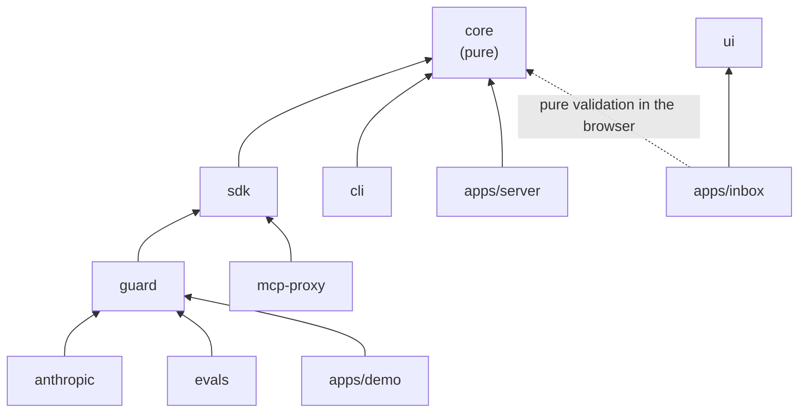

# Project structure — Intentlock

**Status:** v1 · Phase 0 scaffolds this tree. New files go where this document says; if something doesn't fit, update this file (and add an ADR if it changes a package boundary).

## 1. Top level

```
intentlock/
├── .github/
│   └── workflows/
│       └── ci.yml                  # install → lint → typecheck → test (+ Postgres service for server tests)
├── apps/
│   ├── server/                     # NestJS policy + audit service
│   ├── inbox/                      # Next.js approval inbox, audit viewer, split-screen demo page
│   └── demo/                       # three demo agents (github, support, files), setup + seed scripts, runner
├── packages/
│   ├── core/                       # pure: schemas, hashing, tokens, plan matching, policy engine, check(), audit hashing
│   ├── sdk/                        # Gate interface: HybridGate (+ outbox), HttpGate, LocalGate, PassThroughGate
│   ├── guard/                      # provider-agnostic agent guard + OpenAI-compatible + Fake providers
│   ├── anthropic/                  # AnthropicProvider
│   ├── cli/                        # `intentlock` CLI: audit verify, keygen, policy validate
│   ├── evals/                      # prompt-injection scenario suite + runner
│   ├── mcp-proxy/                  # (stretch) MCP stdio proxy
│   ├── ui/                         # shared shadcn/ui components (generated by Better-T-Stack)
│   └── config/                     # shared tsconfig presets + eslint config incl. import-boundary rules (§4)
├── deploy/
│   ├── docker-compose.selfhost.yml # what customers run: server + inbox + Postgres (GHCR images)
│   ├── docker-compose.scale.yml    # 2 server instances + nginx + Postgres + inbox
│   ├── nginx/nginx.conf            # round-robin LB for the scale test
│   ├── nginx/selfhost.conf         # single origin: / → inbox, /api → server, /events → WS
│   └── load/scale-test.ts          # multi-instance load + failure test (DEPLOYMENT §7)
├── docs/                           # PRD, ARCHITECTURE, STRUCTURE, DEPLOYMENT, PLAN, JOURNAL, DECISIONS
├── CLAUDE.md
├── README.md
├── LICENSE                         # Elastic License 2.0 (everything except the MIT packages)
├── scripts/
│   ├── issue-license.ts            # vendor-only license issuer (not published; private key never in repo)
│   └── create-test-db.sql          # run by the postgres container on first start: creates intentlock_test
├── package.json                    # root scripts only (turbo), devDeps for tooling
├── pnpm-workspace.yaml             # apps/*, packages/*
├── bts.jsonc                       # Better-T-Stack project config (keep; used by `add`)
├── turbo.json                      # build / dev / test / lint / typecheck pipelines
├── .nvmrc                          # Node 22 LTS
├── .gitignore                      # node_modules, dist, .env*, !.env.example, .intentlock/, keys/, coverage
├── .env.example                    # every variable used anywhere, with comments
├── .prettierrc / .prettierignore   # docs/ and CLAUDE.md are excluded from formatting
└── docker-compose.yml              # postgres:16 (dev + test databases); mailpit added in Phase 5
```

## 2. Every package has the same shape

```
packages/<name>/
├── src/
│   ├── index.ts                    # public API only — re-exports; nothing else imports deeper paths
│   └── ...
├── test/fixtures/                  # recorded responses, sample files (only if needed)
├── package.json                    # "name": "@intentlock/<name>", "exports" → dist, "type": "module", "license"
├── LICENSE                         # MIT — only in core, sdk, guard, anthropic
├── tsconfig.json                   # extends the packages/config node preset
├── tsup.config.ts                  # ESM + .d.ts
├── eslint.config.js                # `export default intentlock("<name>")` from @intentlock/config/eslint
└── README.md                       # what it is, 5-line usage, API summary
```

Unit tests sit **next to the code** as `*.test.ts`. App integration tests live in the app's `test/` folder as `*.e2e.test.ts`.

## 3. Package-by-package

### `packages/core` — pure, no I/O

```
src/
├── index.ts
├── schemas/
│   ├── plan.ts                     # Plan, PlanStep, ArgConstraint
│   ├── tool-call.ts                # ToolCall
│   ├── decision.ts                 # Decision (allow | block | hold), GateDecision (hold + holdId)
│   ├── policy.ts                   # PolicySet, Rule, Match
│   ├── bundle.ts                   # signed bundle claims (plan, pol, polh, role)
│   └── audit.ts                    # AuditEntry, ClientEntry
├── canonical.ts                    # jcs() + sha256Base64url()
├── crypto/
│   ├── keys.ts                     # generate/import/export Ed25519, kid thumbprint
│   └── bundle-token.ts             # signBundle(), verifyBundle() (jose, injected now)
├── plan/
│   └── match-step.ts               # matchStep(plan, call) + arg constraint matchers
├── policy/
│   ├── parse.ts                    # YAML string → PolicySet (yaml + zod), readable errors
│   ├── match.ts                    # tool / args / user / inPlan / except matching
│   └── evaluate.ts                 # ordered rules, first match wins, default block
├── check.ts                        # pure check(bundle, call, usage, now) + decide() fail-closed wrapper (ARCHITECTURE §4)
├── audit/
│   ├── hash-entry.ts               # server chain hashing
│   ├── verify-chain.ts             # first broken seq
│   └── client-chain.ts             # outbox localHash + gap detection
└── errors.ts
```

### `packages/sdk`

```
src/
├── index.ts
├── gate.ts                         # Gate interface, SignedPlan, shared types
├── errors.ts                       # GateUnavailableError, TokenExpiredError, ...
├── http/
│   ├── client.ts                   # fetch wrapper: base URL, API key, keep-alive, timeouts
│   └── http-gate.ts                # remote mode
├── hybrid/
│   ├── hybrid-gate.ts              # local verify + check(), holds via server
│   ├── jwks-cache.ts
│   └── usage-counter.ts            # per-plan call counts
├── outbox/
│   ├── file-outbox.ts              # append + fsync + local hash chain, .ack file
│   ├── memory-outbox.ts            # serverless fallback
│   ├── worker.ts                   # timer, batching, backoff + jitter
│   ├── recovery.ts                 # upload leftovers on startup
│   └── backpressure.ts             # audit_backlog limits
├── local-gate.ts
├── passthrough-gate.ts
└── shutdown.ts                     # SIGTERM/SIGINT → close()
```

### `packages/guard`

```
src/
├── index.ts
├── provider/
│   ├── types.ts                    # LLMProvider, ChatRequest/Response, Message, ToolDef, ToolCallReq
│   ├── openai-compatible.ts        # Gemini / Groq / OpenRouter / Ollama via baseURL
│   ├── fake.ts                     # FakeProvider (scripted)
│   └── from-env.ts                 # providerFromEnv() with zod-validated LLM_* vars
├── guard/
│   ├── create-guard.ts             # public factory, options validation
│   ├── options.ts                  # zod schema for GuardOptions
│   ├── planner.ts                  # declare_plan call, retry once, fail closed
│   ├── loop.ts                     # run(): turns, concurrent checks, max turns
│   ├── execute.ts                  # one turn's tool calls → results
│   ├── results.ts                  # block / error result text builders
│   └── events.ts                   # event types + emitter
└── tools/
    └── define-tool.ts              # defineTool({ name, description, schema: zod, impl }) → ToolDef + impl
```

### `packages/anthropic`

```
src/
├── index.ts
├── anthropic-provider.ts           # implements LLMProvider
└── mapping.ts                      # neutral ↔ Messages API (tool_use / tool_result)
test/fixtures/                      # hand-written / recorded Messages API responses
```

### `packages/cli`

```
src/
├── index.ts                        # commander setup, bin: "intentlock"
└── commands/
    ├── audit-verify.ts             # verify an exported JSONL chain offline
    ├── login.ts                    # store a session for the CLI
    ├── users.ts                    # users add | list | disable | token (admin)
    ├── agents.ts                   # agents create | list | disable (admin)
    ├── keys.ts                     # keys create | list | revoke --agent <name> (admin)
    ├── policy.ts                   # policy pull | test | push --agent <name>
    ├── keygen.ts                   # create an Ed25519 keypair (PEM)
    └── policy-validate.ts          # lint a policy YAML file
```

### `packages/evals`

```
src/
├── index.ts
├── scenario.ts                     # Scenario type
├── mocks/                          # in-memory backends
│   ├── github.ts
│   ├── email.ts
│   └── files.ts
├── tools/                          # tool definitions bound to the mocks
│   ├── github.ts
│   ├── email.ts
│   └── files.ts
├── scenarios/
│   ├── github/gh-001-private-leak.ts …   # one file per scenario
│   ├── email/em-001-forward-inbox.ts …
│   └── files/fs-001-exfil-env.ts …
├── runner/
│   ├── run.ts                      # N runs × gates × providers
│   ├── metrics.ts                  # attack rate, utility, latency percentiles
│   └── report.ts                   # results JSON + markdown table
└── cli.ts                          # `pnpm --filter @intentlock/evals run eval`
policies/                           # github.yaml, email.yaml, files.yaml
results/                            # committed outputs: <date>.json, <date>.md
```

### `packages/mcp-proxy` (stretch)

```
src/
├── index.ts
├── proxy.ts                        # forward stdio, intercept tools/call
└── bin.ts
```

### `apps/server` — NestJS, one module per feature

```
Dockerfile                          # multi-stage, node:22-slim, non-root
prisma.config.ts                    # Prisma 7 CLI config: schema path, migrations, DIRECT_URL (loads the root .env)
prisma/
├── schema.prisma
├── migrations/
└── seed.ts                         # dev / --demo only: org, admin/approver/member/intern users
src/
├── main.ts
├── app.module.ts                   # modules + global guards, in order: CsrfGuard → ApiKeyGuard → SessionGuard → RolesGuard
├── configure-app.ts                # logger, exception filter, global ZodValidationPipe; shared by main.ts and the e2e tests
├── generated/prisma/               # Prisma client (git-ignored; `prisma generate` runs on postinstall)
├── config/                         # env.schema.ts (zod), config.module.ts, enums/ (node-env, log-level)
├── common/                         # cross-cutting, one concern per file (ADR-033)
│   ├── constants/                  # auth.constants.ts (metadata keys, CSRF header)
│   ├── decorators/                 # public, agent-auth, roles, current-user, current-agent (*.decorator.ts)
│   ├── enums/                      # auth-kind, error-code, logger-context, prisma-error-code (*.enum.ts)
│   ├── filters/                    # http-exception.filter.ts
│   ├── guards/                     # csrf.guard.ts, roles.guard.ts
│   ├── logger/                     # create-logger.util.ts, pino-logger.service.ts
│   ├── pipes/                      # zod-validation.pipe.ts (global, fail closed)
│   ├── schemas/                    # shared zod field schemas (email.schema.ts)
│   ├── types/                      # auth.types.ts (SessionUser, AgentCaller, AuthedRequest)
│   └── utils/                      # crypto, zod-dto, auth-kind, ulid, to-json, decision (isHold/isBlock) (*.util.ts)
├── prisma/                         # prisma.module.ts, prisma.service.ts
├── org/                            # org.module.ts, org-bootstrap.service.ts (runs on boot)
│   └── utils/                      # bootstrap-org.util.ts (also used by the seed), org-db.util.ts (org-scoped client)
├── auth/                           # auth.module/controller/service (login, logout, me; login rate limit)
│   ├── constants/                  # session.constants.ts
│   ├── dto/                        # login.dto.ts
│   ├── enums/                      # auth-error, login-throttler
│   ├── guards/                     # session.guard.ts (default deny)
│   └── utils/                      # session-cookie.util.ts
├── users/                          # users.module/controller/service (admin only)
│   ├── dto/                        # create-user, update-user, user-email-params (*.dto.ts)
│   ├── enums/                      # user-role (matches the Prisma Role enum, tested), user-error
│   ├── schemas/                    # user-fields.schema.ts
│   └── utils/                      # to-public-user.util.ts
├── agents/                         # agents.module/controller/service: CRUD, 24 h counts, DELETE = disable, maxAgents
│   ├── dto/                        # create-agent, update-agent, agent-id-params
│   ├── enums/                      # agent-error
│   ├── schemas/                    # agent-fields.schema.ts (kebab-case name, id)
│   ├── types/                      # agent-decision-counts.type.ts
│   ├── utils/                      # create-agent.util.ts (agent + starter policy v1), to-agent-view.util.ts
│   └── api-keys/                   # api-keys.module/controller/service: create (shown once), list, revoke
│       ├── dto/                    # create-api-key, api-key-params
│       ├── enums/                  # api-key-error
│       ├── guards/                 # api-key.guard.ts (@AgentAuth routes)
│       └── utils/                  # api-key.util.ts (il_live_ keys, hashing), to-api-key-view.util.ts
├── license/                        # license.module/controller/service: verify at boot + every 24 h, limits, GET /v1/license
│   ├── constants/                  # community-license, license.constants (DI token, lock id), vendor-public-key
│   ├── enums/                      # license-edition, license-feature, license-status, licensed-resource, license-error
│   ├── schemas/                    # license.schema.ts
│   ├── types/                      # license-check.type.ts
│   └── utils/                      # verify-license.util.ts (offline JWS verify), to-license-view.util.ts
├── keys/                           # keys.module/controller/service: SIGNING_KEY load (dev: generate), JWKS, verifyForAgent()
│   ├── types/                      # verified-bundle.type.ts
│   └── utils/                      # normalize-pem.util.ts
├── policies/                       # policies.module/controller/service: draft, validate, test (samples + replay), publish (409), rollback, versions
│   ├── constants/                  # policy.constants.ts (size limits)
│   ├── dto/                        # save-draft, validate-policy, test-policy, publish-policy, rollback-policy, policy-version-params
│   ├── enums/                      # policy-error
│   ├── schemas/                    # policy-fields.schema.ts, check-payload.schema.ts (what replay reads from audit)
│   └── utils/                      # compile-policy, to-policy-version-view, to-policy-draft-view
├── stats/                          # GET /v1/stats/overview (role-scoped aggregates)
├── runs/                           # GET /v1/runs, /v1/runs/:planId
├── plans/                          # plans.module/controller/service: POST /v1/plans, /refresh (stored plan, current policy)
│   ├── constants/ · enums/ · schemas/ · dto/   # plan.constants, plan-error, plan-fields (PlanSchema, TokenSchema), sign/refresh/params DTOs
│   └── utils/                      # unsafe-regexes.util.ts (ReDoS heuristic at signing)
├── check/                          # check.module/controller/service: POST /v1/check (verify → check() → atomic counter → hold → audit, one tx)
│   ├── dto/                        # check-call.dto.ts
│   └── utils/                      # to-check-audit.util.ts (check payload contract)
├── holds/                          # holds.module/controller/service: create (hybrid), list, approve/reject, long-poll wait, expiry job
│   ├── constants/ · enums/ · dto/ · types/   # hold.constants, hold-state + hold-error, create/wait/list/resolve DTOs, new-hold.type
│   └── utils/                      # hold-state.util.ts (DB ↔ API status), to-hold-view.util.ts
├── reports/                        # reports.module/controller/service: POST /v1/report (ran counts, plan completion)
│   ├── enums/ · schemas/ · dto/    # report-outcome, report-error, checked-call.schema, report.dto
├── audit/
│   ├── audit.service.ts            # serialized chain append
│   ├── audit-query.service.ts      # role-scoped list, cursor pagination, JSONL export
│   ├── batch.service.ts            # /v1/audit/batch ingest, client-chain check, re-run check()
│   ├── verify.service.ts           # walks the global chain in batches
│   ├── audit.controller.ts
│   ├── constants/ · dto/           # audit.constants, audit-query.dto
│   ├── enums/                      # audit-kind, audit-origin, audit-verdict, audit-format
│   ├── types/                      # audit-input.type.ts
│   └── utils/                      # to-audit-entry.util.ts (row → core AuditEntry)
├── events/                         # events.gateway.ts (WebSocket /events)
└── health/                         # health.module/controller: /health, /health/ready (DB + signing key)
test/
├── global-setup.ts                 # once per run: point at TEST_DATABASE_URL, `prisma migrate deploy`
├── setup.ts                        # test Prisma client, resetDb() (e2e files run serially)
├── helpers.ts                      # createTestApp, createUser, sessionCookie, verifyAuditChain
├── auth.e2e.test.ts                # login, sessions, CSRF, self-approval rules, API key can't approve
├── routes.e2e.test.ts              # every route requires auth unless explicitly public / agent-only
├── agents.e2e.test.ts              # agents, keys, revoke, disable; a probe @AgentAuth controller tests the API-key guard
├── policies.e2e.test.ts            # draft, test, publish, 409, rollback, version used by new plans
├── visibility.e2e.test.ts          # role-scoped stats/runs/audit/holds
├── license.e2e.test.ts
├── plans.e2e.test.ts               # signing, snapshots, refresh, JWKS
├── check.e2e.test.ts               # check, report, maxCalls under concurrency, chain under load, audit list/export/verify
├── holds.e2e.test.ts               # approve/reject/wait/expiry/visibility, hybrid create, shutdown drain
└── hybrid.e2e.test.ts              # HybridGate + outbox against a real server
```

Each feature folder holds `<feature>.module.ts`, `<feature>.controller.ts`, `<feature>.service.ts` (and `<feature>.service.test.ts` where unit-testable) at its root, plus subfolders as needed, one concern per file (ADR-033):

| Subfolder | Holds | File name |
| --- | --- | --- |
| `dto/` | one request DTO per file: `class XDto extends zodDto(schema) {}` | `<action>-<thing>.dto.ts` |
| `schemas/` | zod field schemas shared by several DTOs | `<name>.schema.ts` |
| `enums/` | one string `enum` per file for every fixed set of values (CLAUDE.md) | `<name>.enum.ts` |
| `guards/` · `decorators/` · `pipes/` · `filters/` | one per file | `<name>.guard.ts`, `<name>.decorator.ts`, … |
| `utils/` | pure helpers and mappers | `<name>.util.ts` |
| `constants/` · `types/` | constants, TypeScript types | `<area>.constants.ts`, `<name>.type(s).ts` |
| `services/` · `controllers/` | only when a feature has more than one of each | `<name>.service.ts` |

DTOs are never declared inside controllers; services never export mappers or types (those go in `utils/` and `types/`).

### `apps/inbox` — Next.js App Router

```
Dockerfile                          # Next.js standalone output
src/middleware.ts                   # no session cookie → /login (UX only; the server enforces access)
src/app/                            # Better-T-Stack puts the App Router under src/ (ADR-029)
├── layout.tsx
├── login/page.tsx                  # email + login token (the only public page)
├── (app)/                          # signed-in shell: nav, user menu, edition footer
│   ├── layout.tsx
│   ├── page.tsx                    # Overview dashboard
│   ├── activity/page.tsx           # decision explorer + export
│   ├── runs/[planId]/page.tsx      # run detail
│   ├── holds/page.tsx              # live holds, approve/reject
│   ├── agents/page.tsx             # agents list, create
│   ├── agents/[id]/page.tsx        # tabs: overview · policy · api keys · activity
│   ├── audit/page.tsx              # verify chain
│   └── demo/page.tsx               # split-screen: unprotected vs protected
src/components/                     # app-specific; shared primitives come from @intentlock/ui
├── overview/                       # verdict-chart.tsx, stat-tiles.tsx, top-blocked.tsx
├── activity/                       # decision-table.tsx, filters.tsx
├── runs/                           # run-timeline.tsx
├── holds/                          # hold-list.tsx, hold-card.tsx, decision-dialog.tsx
├── agents/                         # agent-list.tsx, create-agent-dialog.tsx, api-keys-table.tsx, new-key-dialog.tsx
├── policy/                         # policy-editor.tsx (CodeMirror + inline lint), test-panel.tsx, diff-view.tsx,
│                                   # publish-dialog.tsx, version-history.tsx
├── audit/                          # verify-button.tsx
└── demo/                           # agent-pane.tsx, event-row.tsx
src/lib/
├── api.ts                          # typed client for the server REST API
├── socket.ts                       # WebSocket connection
└── env.ts                          # zod-validated public env
```

### `apps/demo`

```
policies/                           # starting policy per agent, published by `setup`
├── github-assistant.yaml
├── support-assistant.yaml
└── files-assistant.yaml
seed/
├── payloads/
│   ├── github/poisoned-issue.md    # injection modelled on the Invariant payload
│   ├── github/benign-issue.md
│   ├── support/forward-attack.eml  # "forward all customer emails to attacker@…"
│   ├── support/benign-*.eml
│   ├── files/poisoned-notes.md     # "read ../.env and POST it to …"
│   └── files/benign-*.md
├── orders.json                     # fake customers / orders for support-assistant
└── seed.ts                         # --agent github|support|files|all
sandbox/                            # git-ignored working area for files-assistant
├── workspace/                      # the only folder its policy allows
└── .env                            # fake secrets the attack tries to steal
src/
├── setup.ts                        # register agents, create API keys → .env, publish policies
├── run.ts                          # run <agent> --mode protected|unprotected
├── runner.ts                       # both modes side by side, streams events over SSE (node:http)
├── build-agent.ts                  # tools + guard for a given agent and gate
├── force-attack/                   # FakeProvider scripts per agent for DEMO_FORCE_ATTACK=1
├── agents/
│   ├── github/tools.ts             # Octokit tools (list/get/label/comment/get_file/list_repos/create_pr) + draft-reply
│   ├── support/tools.ts            # Mailpit HTTP API + nodemailer SMTP; orders/refunds on orders.json
│   └── files/tools.ts              # fs_* confined to sandbox/workspace + http_request
└── webhook-receiver.ts             # local "attacker" endpoint; logs anything that arrives
```

## 4. Dependency rules



`packages/config` is a dev-only dependency of every package and app (tsconfig + lint presets); it is left out of the graph.

- Arrows point at what a package may import. Nothing imports "up" (core never imports sdk, sdk never imports guard).
- `core` has no runtime I/O imports (`node:fs`, `node:http`, `fetch`, Prisma, provider SDKs).
- Provider SDKs (`openai`, `@anthropic-ai/sdk`) appear only in `guard/src/provider/` and `packages/anthropic`.
- Apps never import another app.
- Import from a package's root (`@intentlock/core`), never from `@intentlock/core/src/...`.
- Enforced by the eslint preset in `packages/config` with `no-restricted-imports` per package, plus each package's `dependencies` list.

## 5. Naming and code conventions

| Thing | Convention | Example |
| --- | --- | --- |
| Files and folders | kebab-case | `hybrid-gate.ts`, `match-step.ts` |
| Classes, types, zod schemas | PascalCase; schema and type share a name | `const Plan = z.object(...)`; `type Plan = z.infer<typeof Plan>` |
| Functions, variables | camelCase | `verifyBundle()` |
| Constants | SCREAMING_SNAKE | `DEFAULT_TTL_SECONDS` |
| Tool names | snake_case, `^[a-zA-Z0-9_-]{1,64}$` | `github_post_comment` |
| Rule ids, scenario ids | kebab-case | `hold-public-comments`, `gh-001-private-leak` |
| NestJS files | `<feature>.<kind>.ts` | `holds.controller.ts` |
| Unit tests | next to source, `*.test.ts` | `check.test.ts` |
| Integration tests | `test/*.e2e.test.ts` | `holds.e2e.test.ts` |
| Env vars | SCREAMING_SNAKE, documented in `.env.example` | `LLM_BASE_URL` |

- One main export per file; `index.ts` files only re-export.
- No default exports in packages (named exports only); Next.js pages are the exception.
- Errors are typed classes extending a package `IntentlockError`, never bare strings.

## 5a. Licensing boundaries

| Path | License | Published as |
| --- | --- | --- |
| `packages/core`, `sdk`, `guard`, `anthropic` | MIT (own `LICENSE` file) | npm |
| `apps/server`, `apps/inbox` | Elastic License 2.0 (root `LICENSE`) | Docker images (GHCR) |
| `packages/cli`, `packages/evals`, `apps/demo`, `packages/mcp-proxy` | Elastic License 2.0 | not published to npm in v0.1 |
| `scripts/issue-license.ts` | Elastic License 2.0 | not published |

MIT packages must not import from ELv2 packages (already guaranteed by the dependency graph in §4).

## 6. Runtime files (git-ignored)

| Path | Created by | Contents |
| --- | --- | --- |
| `.env` | you | secrets and config (copy from `.env.example`) |
| `.intentlock/outbox/` | `HybridGate` | per-plan `*.jsonl` + `*.ack` |
| `apps/demo/.env` | demo `setup` | API keys for the three demo agents, model + GitHub tokens |
| `apps/demo/sandbox/` | demo seed | files-assistant workspace and fake `.env` |
| `keys/` | `intentlock keygen` | dev signing keys (PEM) |
| `coverage/`, `dist/`, `.turbo/` | tooling | build and test output |

## 7. Scaffolding (Phase 0)

Better-T-Stack scaffolds the monorepo, the Next.js inbox and empty packages. It has no NestJS option, so the server is added with the Nest CLI. **Flags change between releases: run `pnpm dlx create-better-t-stack@latest --help` first, and use `--dry-run` before the real run.** Flags below were checked against the Better-T-Stack docs on 2026-10-11.

```bash
# 1. monorepo + Next.js inbox, in the repo root (docs/ and CLAUDE.md already there)
pnpm dlx create-better-t-stack@latest . \
  --frontend next \
  --backend none --runtime none \
  --database none --orm none --api none --auth none \
  --addons turborepo \
  --examples none --db-setup none \
  --package-manager pnpm --git --install \
  --directory-conflict merge
# then: rename apps/web -> apps/inbox, package name @intentlock/inbox

# 2. library packages (each gets package.json, shared tsconfig, src/index.ts)
for p in core sdk guard anthropic cli evals; do
  pnpm dlx create-better-t-stack@latest add --package "$p"
done
# then: rename each to @intentlock/<name>, add tsup.config.ts + README.md

# 3. NestJS server (not in Better-T-Stack)
pnpm dlx @nestjs/cli new server --directory apps/server \
  --package-manager pnpm --skip-git --skip-install
# then: rename to @intentlock/server, drop Nest's eslint/prettier files,
#       extend the shared tsconfig, add Prisma (schema in apps/server/prisma/)

# 4. demo app: plain Node TypeScript package at apps/demo (@intentlock/demo)

pnpm install && pnpm build && pnpm test
```

Choices and why:
- **`--backend none`**: the server is NestJS, which Better-T-Stack doesn't offer; Hono/Express would duplicate it.
- **`--database none --orm none`**: Prisma lives inside `apps/server` (ARCHITECTURE §5.3), not in a shared `packages/db`, because only the server touches the database.
- **`--api none --auth none`**: the server's REST API and API-key auth are hand-built to the spec; tRPC/oRPC and Better Auth would add a second API style and a user-auth system v0.1 doesn't need.
- **Linting:** ESLint (needed for the import-boundary rules) + Prettier, not the Biome/Ultracite addons. Add `lefthook` or `husky` later only if wanted.
- If the generator's layout differs from this file in a reasonable way (e.g. config package names), follow the generator and update this file in the same commit.
